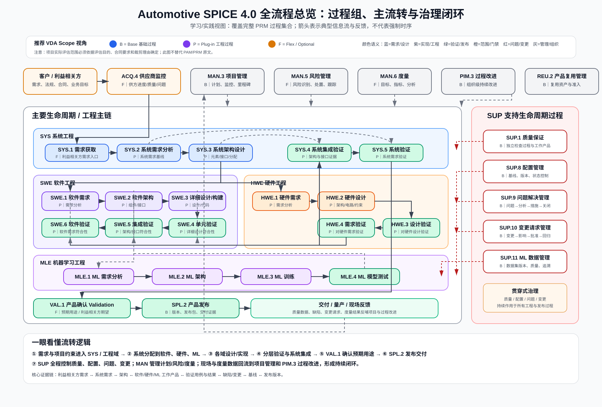

# Automotive SPICE 4.0 全流程总览

> **定位**：ASPICE 方法论学习与项目实践的全局入口，不局限于 V 模型开发链。  
> **状态**：Draft / 学习与实践参考。正式评估以项目采用的 Automotive SPICE PAM/PRM、VDA 指南、客户要求及裁剪结果为准。

## 1. 一张图看全局

这张图按 Automotive SPICE 4.0 的完整过程参考模型组织，同时叠加推荐 VDA Scope 的 Base / Plug-in / Flex-Optional 学习视角。它用于回答三个问题：

1. **ASPICE 有哪些过程？**
2. **开发过程之间如何流转？**
3. **管理、质量、配置、问题、变更和改进如何贯穿开发并形成闭环？**

## 2. Automotive SPICE 4.0 的 3 类过程

Automotive SPICE 4.0 将过程组组织为三大类别：

### 2.1 主要生命周期过程（Primary Life Cycle Processes）

- **ACQ**：`ACQ.4 Supplier Monitoring`
- **SPL**：`SPL.2 Product Release`
- **SYS**：`SYS.1 ~ SYS.5`
- **VAL**：`VAL.1 Validation`
- **SWE**：`SWE.1 ~ SWE.6`
- **MLE**：`MLE.1 ~ MLE.4`
- **HWE**：`HWE.1 ~ HWE.4`

### 2.2 支持生命周期过程（Supporting Life Cycle Processes）

- `SUP.1 Quality Assurance`
- `SUP.8 Configuration Management`
- `SUP.9 Problem Resolution Management`
- `SUP.10 Change Request Management`
- `SUP.11 Machine Learning Data Management`

### 2.3 组织生命周期过程（Organizational Life Cycle Processes）

- **MAN**：`MAN.3 Project Management`、`MAN.5 Risk Management`、`MAN.6 Measurement`
- **PIM**：`PIM.3 Process Improvement`
- **REU**：`REU.2 Management of Products for Reuse`

完整 PRM 共 **32 个过程**。

## 3. 流程之间如何流转

### 3.1 项目入口

典型输入包括：客户/利益相关方需求、法规、合同、组织目标和供应链约束。

主要进入：

`客户/利益相关方 → SYS.1 → SYS.2 → SYS.3`

对于有外部供方的项目，`ACQ.4` 持续监控供应商进度、质量、交付和问题；它不是单纯开发链上的一个阶段，而是贯穿供应链协作。

### 3.2 系统向工程域分解

`SYS.3` 建立系统架构、系统元素、接口和分配关系后，将需求分配到不同工程域：

- 软件 → `SWE.1 ~ SWE.6`
- 硬件 → `HWE.1 ~ HWE.4`
- 机器学习 → `MLE.1 ~ MLE.4`（项目涉及 ML 时）

这些工程域不是彼此孤立，而是通过系统接口、系统架构和集成计划在 SYS 层重新汇合。

## 4. 正确理解 V 型验证关系

V 模型只是工程过程的一部分。用于理解验证对象时，可以保留以下关键映射：

| 开发/定义过程 | 对应验证过程 | 主要回答的问题 |
|---|---|---|
| `SYS.2` 系统需求分析 | `SYS.5` 系统验证 | 最终系统是否满足系统需求？ |
| `SYS.3` 系统架构设计 | `SYS.4` 系统集成与集成验证 | 系统元素和接口是否满足系统架构？ |
| `SWE.1` 软件需求分析 | `SWE.6` 软件验证 | 软件是否满足软件需求？ |
| `SWE.2` 软件架构设计 | `SWE.5` 软件组件验证与集成验证 | 软件组件和接口是否满足软件架构？ |
| `SWE.3` 软件详细设计与单元构建 | `SWE.4` 软件单元验证 | 单元是否满足详细设计？ |
| `HWE.2` 硬件设计 | `HWE.3` 对硬件设计的验证 | 实现是否符合硬件设计？ |
| `HWE.1` 硬件需求分析 | `HWE.4` 对硬件需求的验证 | 硬件是否满足硬件需求？ |

> 🔵 **核心原理**：横向关系表达“验证对象与验证层级”，不是项目必须按一次性瀑布顺序执行。迭代、敏捷和增量开发仍可采用，但追溯、验证和客观证据必须闭环。

## 5. Validation 与 Verification 不要混淆

- **Verification**：工作产品/实现是否符合已定义的需求、架构或设计。
- **VAL.1 Validation**：最终产品在预期使用环境下是否满足利益相关方的预期用途。

因此，`VAL.1` 不应被简单画成 `SYS.5` 的同义词。它位于更靠近产品用途、客户场景和最终交付价值的一层。

## 6. SUP 为什么必须横向贯穿

### SUP.1 质量保证

持续检查过程和工作产品是否符合既定要求，并对不符合项进行跟踪。

### SUP.8 配置管理

管理配置项、版本、基线和状态，使任何评估证据都能回答“这是哪个版本”。

### SUP.9 问题解决管理

典型闭环：

`发现问题 → 分类/分析 → 处理措施 → 验证 → 关闭 → 经验反馈`

### SUP.10 变更请求管理

典型闭环：

`提出变更 → 影响分析 → 评审批准 → 实施 → 回归验证 → 基线更新`

### SUP.11 ML 数据管理

当项目涉及机器学习时，数据本身也成为受控工程资产，需要版本、质量、来源和可追溯性管理。

## 7. MAN / PIM / REU 如何形成治理闭环

### MAN.3 项目管理

定义范围、计划、资源、接口、里程碑并持续监控偏差。

### MAN.5 风险管理

风险识别、分析、处置和跟踪，与项目计划和技术决策互相影响。

### MAN.6 度量

将项目状态从“感觉”转化为可度量证据，例如需求成熟度、缺陷趋势、测试通过率、变更趋势和里程碑偏差。

### PIM.3 过程改进

将项目问题、评估发现、度量结果和经验教训回流到组织过程，实现持续改进。

### REU.2 产品复用管理

对复用资产建立准入、维护和版本责任，避免“复制旧项目代码”被误认为受控复用。

## 8. 推荐 VDA Scope 的学习视角

VDA Automotive SPICE Guidelines 2.0 基于 Automotive SPICE 4.0，将推荐评估范围组织为：

- **Base**：基础过程
- **Plug-in**：至少选择一个适用的工程域，例如 SYS、SWE、HWE、MLE
- **Flex / Optional**：根据评估目的扩展

这意味着“ASPICE = SWE V 模型”是不完整的。真实项目实践应先确定评估目的和适用范围，再选择需要评估和重点治理的过程。

## 9. EVCC 项目如何使用这张图

以 EVCC 为例，建议从以下链路开始落地：

`客户/法规/充电协议需求`
→ `SYS.1 / SYS.2`
→ `SYS.3 系统架构与接口分配`
→ `SWE.1~6 + HWE.1~4`
→ `SYS.4 / SYS.5`
→ `VAL.1 车辆/充电场景确认`
→ `SPL.2 发布`

同时全过程挂接：

`MAN.3 + SUP.1 + SUP.8 + SUP.9 + SUP.10`

如涉及外部 EVCC 供应商，再加入 `ACQ.4`；如项目强调项目风险或量化指标，再重点纳入 `MAN.5 / MAN.6`。

## 10. 学习顺序建议

1. 先用本总览图理解 **过程全景和信息流**。
2. 再看 `aspice-v-model.svg`，学习 SYS/SWE 的开发—验证对应关系。
3. 再看 `aspice-engineering-loop.svg`，学习需求、设计、代码、测试、缺陷和变更闭环。
4. 最后进入各过程实践手册和 EVCC 案例，把每个过程落实为工作产品和客观证据。

## 11. 权威参考

- VDA QMC, **Automotive SPICE Process Assessment / Reference Model, Version 4.0**, 2023-11-29。
- VDA QMC, **Automotive SPICE Guidelines, Version 2.0**，Recommended VDA Scope 基于 Automotive SPICE 4.0。

> 🟠 **使用边界**：本文件和配图是学习/工程实践的结构化总结，不替代 Automotive SPICE 官方 PAM/PRM、VDA 指南、客户特定要求或正式 assessor 判断。
