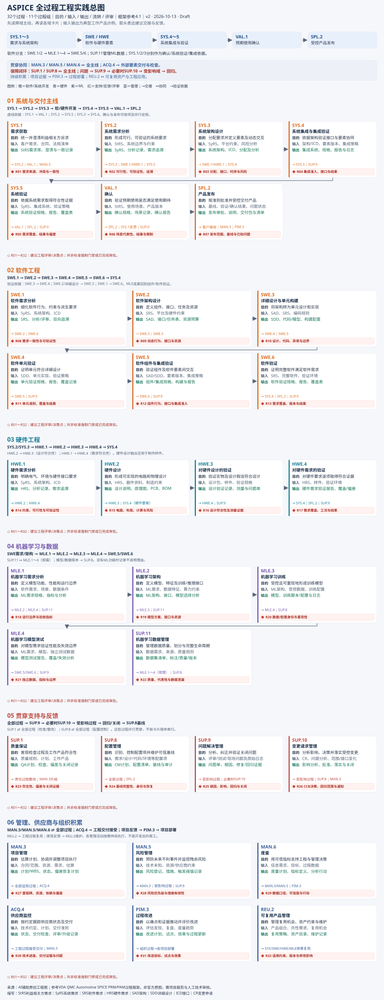
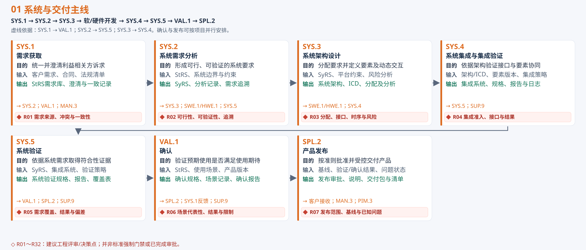
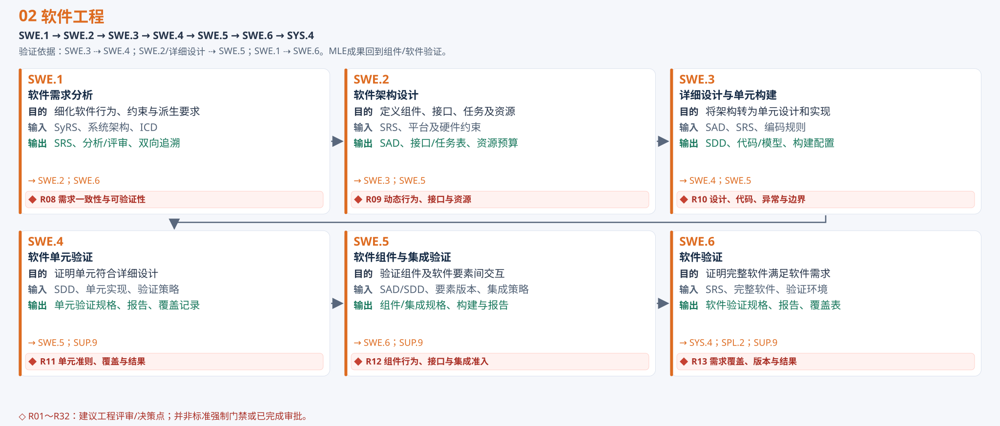
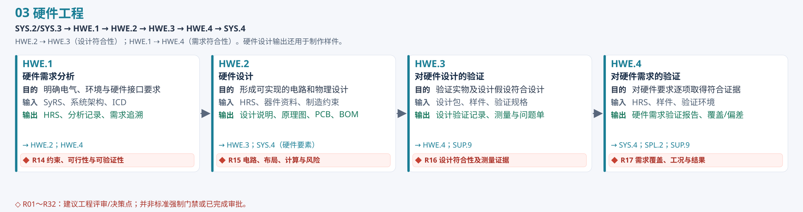
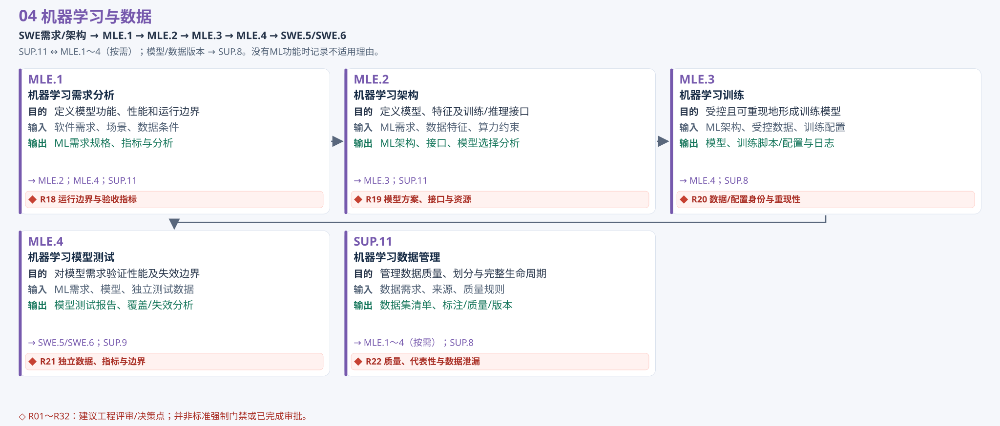
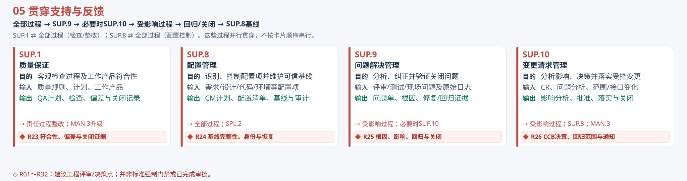
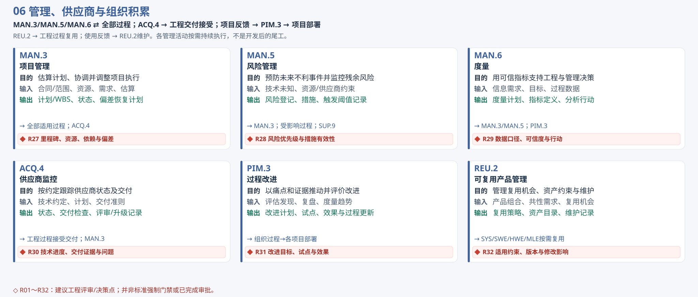
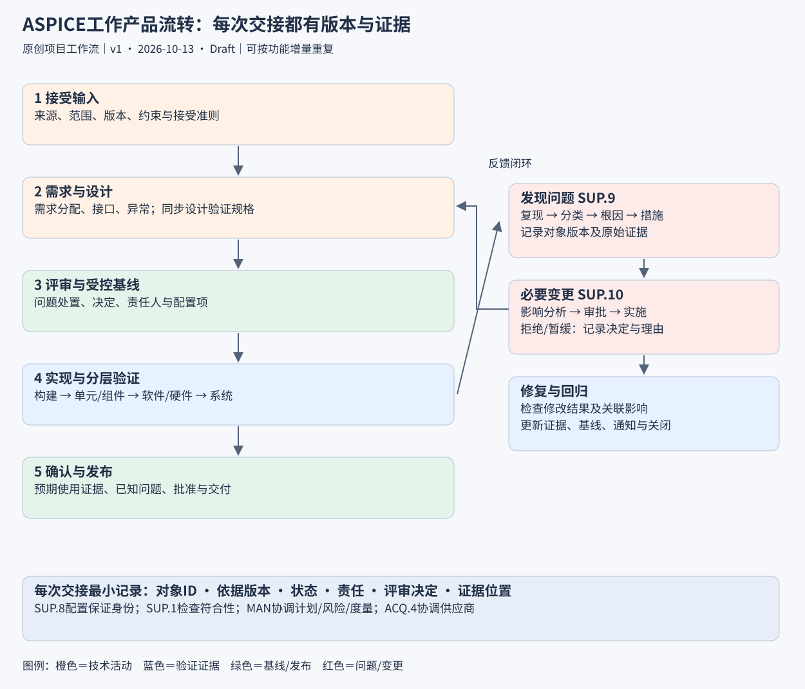

# ASPICE工程实践指南
> 状态：Draft｜框架版本：Automotive SPICE 4.1 PRM/PAM（2026-08-24）｜编写与来源核验：2026-10-13（北京时间）  
> 适用：汽车电子系统、ECU、EVCC及其软件/硬件开发；面向有研发经验的工程师、项目经理与质量人员。  
> 标签：aspice、system-architecture、traceability、verification、evcc  
> 本文为原创工程实施建议，不是官方过程模型的翻译、评估结论或指定生命周期。过程编号采用官方框架；文件名、角色安排、门禁和数值案例均为建议，需按合同、组织过程及项目范围裁剪。

## 1. 先看总图：ASPICE如何落到项目上

[打开SVG原图并放大查看](images/aspice-all-process-io-review-v2.svg)

**图1说明：** 新版覆盖11个过程组中的全部32个过程，每个过程独立列出核心目的、典型输入、输出、下游流向及红色菱形评审点。顶部先看跨域主线，各分区再看具体交接。卡片底部的“→”列出主要下游；“↔”表示协同或反馈；“⇢”表示验证依据，不能当作执行顺序。跨域分配、集成、问题变更、供应商与组织反馈在顶部及分区流转带明确标识。

**评审点：** R01～R32为建议的技术评审、符合性检查或管理决策点，编号只用于本文；不表示ASPICE规定了32个强制门禁，也不表示评审已完成。技术工作产品在受控交接前评审，验证规格在执行前评审、验证结果在交接前复核；管理与支持记录按事件及周期检查。每次需保留对象版本、评审人、结论、问题/措施和关闭证据。

**颜色与边界：** 橙色为系统/软件工程，青色为硬件，紫色为ML与数据，红色为支持/反馈/评审，蓝色为管理协同；输入为灰色、输出为绿色，并配文字标签。箭头表示建议的主要交接关系，支持与管理过程并行贯穿；可按功能增量迭代。输入/输出为典型文件或记录示例，不是完整官方工作产品清单。ML只在适用时执行。

**来源与状态：** AI辅助原创SVG工程概念图，参考指南中已登记的VDA QMC Automotive SPICE 4.1过程框架；v2，2026-10-13，Draft。不是官方原图或正式审批证据。已完成本地SVG渲染与文字边界检查，实际GitHub页面渲染及人工技术审核仍需核验。

### 分区放大图

总图与下列分区图采用同一套过程内容；分区图用于直接阅读，每图的来源、日期、版本、图例与审核状态同图1。

01 系统与交付主线（展开查看输入、输出及评审）

**图1-01：系统与交付主线。** 卡片给出目的、输入、输出、主要流向及建议评审点；Draft。点击图片可放大。

02 软件工程（展开查看输入、输出及评审）

**图1-02：软件工程。** 卡片给出目的、输入、输出、主要流向及建议评审点；Draft。点击图片可放大。

03 硬件工程（展开查看输入、输出及评审）

**图1-03：硬件工程。** 卡片给出目的、输入、输出、主要流向及建议评审点；Draft。点击图片可放大。

04 机器学习与数据（展开查看输入、输出及评审）

**图1-04：机器学习与数据。** 卡片给出目的、输入、输出、主要流向及建议评审点；Draft。点击图片可放大。

05 贯穿支持与反馈（展开查看输入、输出及评审）

**图1-05：贯穿支持与反馈。** 卡片给出目的、输入、输出、主要流向及建议评审点；Draft。点击图片可放大。

06 管理、供应商与组织积累（展开查看输入、输出及评审）

**图1-06：管理、供应商与组织积累。** 卡片给出目的、输入、输出、主要流向及建议评审点；Draft。点击图片可放大。

**旧版记录：** [v1工程总览图](images/aspice-engineering-overview-v41.svg)保留供历史比较；当前阅读以v2全量图为准。

**工程重点：一条需求必须能回答“来源是什么、谁实现、如何验证、哪个版本通过、变更后影响什么”。**

ASPICE提供过程参考与过程评估框架。过程维度关心做什么、取得什么结果；能力维度关心过程如何稳定执行。项目可以采用迭代、敏捷、模型开发或阶段门。图中顺序是一种实施方式，不代表必须完成全部文档后才能进入下一步。

本文覆盖基础PRM/PAM中的32个过程。项目启动时先确定哪些过程适用、哪些进入评估范围；无机器学习功能的EVCC项目通常不开展MLE与SUP.11，需记录理由。功能安全、网络安全等还需要各自适用的标准与补充模型，不能由ASPICE替代。

### 阅读路线

| 当前问题 | 优先阅读 |
|---|---|
| 不知道ASPICE如何开始 | 第1、2、9节 |
| 不知道每个过程干什么、交付什么 | 第3、4节 |
| 文件齐了但流转不起来 | 第5、6、7节 |
| 想用EVCC项目练习 | 第8节 |
| 准备能力提升与评估抽样 | 第10、11节 |

## 2. 建立项目边界与责任，再写需求

**第一步交付一份《过程适用性与责任表》**：列明产品边界、开发范围、外包边界、模型版本、过程适用性、目标能力等级、责任人、评审人、工作产品及存储位置。

例如，“EVCC软件开发”与“整车充电系统开发”不是同一边界。前者的系统级证据可能由客户提供，后者需要覆盖EVCC、BMS、VCU、充电口及功率执行链。不能把“别人负责”当作无证据的理由；应规定输入接受准则与接口责任。

| 角色 | 对什么结果负责 | 实际动作 |
|---|---|---|
| 项目经理PM | 范围、计划、资源、进度与风险 | 维护WBS、依赖、偏差与恢复计划 |
| 系统负责人 | 系统需求、架构、系统接口与系统验证闭环 | 组织软硬件及车辆接口评审 |
| 软件负责人 | 软件需求、架构、实现和软件验证闭环 | 维护任务、接口及软件版本 |
| 硬件负责人 | 硬件需求、设计与硬件验证 | 维护原理图、PCB、BOM与板版本 |
| 验证负责人 | 策略、环境、用例、结果及回归 | 对失败、阻塞、未执行分别处理 |
| 配置管理员CM | 可重现的基线及交付版本 | 管理配置项、构建、权限与发布标签 |
| 质量保证QA | 过程与工作产品符合性、偏差关闭 | 保持必要客观性，独立上报未解决偏差 |
| 变更决策人员/CCB | 变更取舍及影响承担 | 审批范围、成本、交期及回归方案 |
| 供应商接口人 | 外部交付与问题升级 | 按ACQ.4执行检查与沟通 |

小团队可以兼岗，但重要评审、质量上报与审批不能只剩作者自我确认。授权、替补、升级渠道要在项目计划中写清。

## 3. 工程主线：每个过程的输入、动作与输出

下表中文名称为阅读用释义。**文件名均为建议，不是ASPICE强制命名；数据库条目、模型、代码与工具记录也可以是工作产品。** 一个文件可承载多个信息项，同一信息项也可由多个受控记录共同证明。输入输出不是完整官方清单。

### 3.1 SYS：先说明系统应该做什么，再证明整个系统做到了

| 过程 | 核心工程动作与重点 | 主要输入文件/记录 | 建议输出文件/记录 | 结果交给谁 |
|---|---|---|---|---|
| SYS.1 需求获取 | 识别客户、法规、平台、制造、售后等诉求；澄清冲突并达成一致 | 客户需求书、合同技术附件、法规标准清单、现场问题 | 利益相关方需求库、需求澄清记录、需求变更记录 | SYS.2、VAL.1、MAN.3 |
| SYS.2 系统需求分析 | 转换为可分析、可验证的系统要求；检查可行性、依赖、优先级 | 利益相关方需求库、系统边界、约束 | 系统需求规格书SyRS、需求分析/评审记录、需求追溯表 | SYS.3、SYS.5、SWE.1、HWE.1 |
| SYS.3 系统架构设计 | 划分系统要素、分配要求；定义接口、状态、时序与跨要素行为 | SyRS、平台约束、设计风险分析 | 系统架构说明、接口控制文档ICD、需求分配表、架构分析/评审记录 | 软硬件设计、SYS.4 |
| SYS.4 系统集成与集成验证 | 按集成顺序组装系统要素，验证接口及交互 | 系统架构/ICD、要素交付、集成策略与环境配置 | 系统集成计划、集成验证规格、系统构建清单、执行日志与报告、缺陷单 | SYS.5、SUP.9 |
| SYS.5 系统验证 | 按系统需求证明系统符合要求；选择与发布范围对应的验证集合 | SyRS、集成系统、系统验证策略 | 系统验证规格与追溯、系统验证报告、原始证据、结果摘要 | VAL.1、SPL.2、SUP.9 |

**SYS.4与SYS.5的分界：** “EVCC与BMS信号字节序、周期及超时交互正确”主要依据架构与接口；“系统在规定故障条件下进入规定状态”依据系统需求。设备可以相同，但验证对象、依据与覆盖关系必须明确。

### 3.2 SWE：软件需求—架构—单元—组件—完整软件

| 过程 | 核心工程动作与重点 | 主要输入文件/记录 | 建议输出文件/记录 | 结果交给谁 |
|---|---|---|---|---|
| SWE.1 软件需求分析 | 把分配给软件的系统要求细化成可验证行为；保留派生要求理由 | SyRS、系统架构、ICD、平台/资源限制 | 软件需求规格书SRS、分析与评审记录、系统-软件追溯 | SWE.2、SWE.6 |
| SWE.2 软件架构设计 | 定义组件、接口、任务、资源和动态交互；分析架构选择 | SRS、AUTOSAR/平台约束、硬件接口 | 软件架构说明SAD、接口/任务表、资源预算、需求分配与评审 | SWE.3、SWE.5 |
| SWE.3 详细设计与单元构建 | 将组件细化为单元与算法；定义异常、边界、数据和实现 | SAD、SRS、编码规范 | 详细设计SDD、源代码/模型、代码评审、构建配置、设计-代码追溯 | SWE.4、SWE.5 |
| SWE.4 软件单元验证 | 验证单元是否符合详细设计；按风险选择验证措施 | SDD、单元实现、单元验证策略 | 单元验证规格、单元测试/静态检查报告、覆盖与偏差记录 | SWE.5、SUP.9 |
| SWE.5 软件组件与集成验证 | 验证组件行为和软件要素间接口，按顺序集成 | SAD/SDD、单元/组件版本、集成策略 | 组件验证规格、集成验证规格、集成构建、结果/回归报告 | SWE.6、SYS.4 |
| SWE.6 软件验证 | 在完整软件层面对软件需求取得证据 | SRS、完整软件、验证环境与发布范围 | 软件验证规格、需求覆盖表、结果报告、原始日志、缺陷单 | SYS.4、SPL.2 |

**重点：测试设计提前开展。** SRS评审时同步检查能否写出用例；SAD评审时同步设计组件与接口验证。SWE.4不仅是运行单元测试，SWE.5也不能只写“软件编译成功”。覆盖率目标按风险、项目规范与适用安全要求确定，本文不设通用强制百分比。

### 3.3 HWE：硬件设计依据与硬件需求分开验证

| 过程 | 核心动作 | 主要输入 | 建议输出 | 流转 |
|---|---|---|---|---|
| HWE.1 硬件需求分析 | 明确电气、时序、环境、接口、诊断与约束 | SyRS、系统架构、ICD | 硬件需求规格HRS、可行性/评审、追溯 | HWE.2、HWE.4 |
| HWE.2 硬件设计 | 设计架构、电路、器件、布局及分析取舍 | HRS、器件资料、制造约束 | 硬件设计说明、原理图、PCB、BOM、计算/仿真与评审 | HWE.3、制造、SYS.4 |
| HWE.3 对硬件设计的验证 | 核对实物与设计及设计假设的一致性 | 硬件设计包、样件、验证规格 | 设计验证记录、测量原始数据、板级调试/问题记录 | HWE.4、SUP.9 |
| HWE.4 对硬件需求的验证 | 对HRS逐项取得符合性证据 | HRS、样件、验证环境 | 硬件需求验证规格、报告、覆盖与偏差清单 | SYS.4、SPL.2 |

例如CP采集电路：器件装配、RC设计响应、实际电路实现可服务于设计验证；需求规定的输入量程、精度、温度条件下性能则需要需求验证。不能仅按“板测/整机测”区分HWE.3与HWE.4。

### 3.4 VAL与SPL：使用场景与受控发布

| 过程 | 核心动作 | 主要输入 | 建议输出 | 重点 |
|---|---|---|---|---|
| VAL.1 确认 | 在预期使用场景下判断产品是否满足利益相关方期待 | 利益相关方需求、使用场景、产品版本、确认策略 | 确认计划/规格、场景与条件记录、确认报告、偏差 | 验证规格正确，不自动等于用户使用目标达成 |
| SPL.2 产品发布 | 明确发布内容、准则、审批、交付与通知 | 产品基线、验证结果、问题状态、发布条件 | 发布审批、发布说明、交付包与清单、已知问题、接收记录 | 只交付明确身份且可重现的版本 |

EVCC系统测试通过某一协议场景，是需求符合性的证据；在预期地区、车型和桩型组合下能否顺利充电，则需要明确确认场景与样本边界。互操作百分比必须保留分母、对象、版本和失败定义，不能直接写“兼容性100%”而无范围。

### 3.5 MLE：仅在产品包含机器学习时进入主线

| 过程 | 核心动作 | 主要输入 | 建议输出 |
|---|---|---|---|
| MLE.1 机器学习需求分析 | 明确模型功能、性能、运行域及约束 | 软件需求、应用场景、数据条件 | ML需求规格、验收指标与评审 |
| MLE.2 机器学习架构 | 定义特征、模型结构、训练/推理接口与资源 | ML需求、数据特征、算力限制 | ML架构与接口、模型选择分析 |
| MLE.3 机器学习训练 | 可重现地执行训练并管理训练结果 | ML架构、受控数据、训练配置 | 训练脚本/配置、训练日志、模型版本与指标 |
| MLE.4 机器学习模型测试 | 对模型需求进行测试并分析适用边界 | ML需求、模型、独立测试数据与规格 | 模型测试报告、场景覆盖、失效分析 |
| SUP.11 机器学习数据管理 | 管理采集、标注、质量、划分、访问与版本 | 数据需求、数据来源、质量标准 | 数据集清单、质量/标注记录、划分与版本清单 |

**工程建议：** 数据集身份与模型身份绑定；避免训练、调参与最终测试的数据泄漏；对类别失衡、地域差异、场景漂移单独分析。MLE成果需要回到软件与系统集成，不能只提供一份准确率报告。

## 4. 横向过程：使主线可以持续运行

### 4.1 SUP：质量、配置、问题与变更

| 过程 | 实际在做什么 | 主要输入 | 建议输出 | 工程检查点 |
|---|---|---|---|---|
| SUP.1 质量保证 | 按计划客观检查过程与工作产品符合性，推动偏差关闭 | 项目过程、质量准则、工作产品、执行记录 | QA计划、检查报告、偏差单、升级与关闭证据 | QA检查不能替代技术评审或测试 |
| SUP.8 配置管理 | 识别配置项、控制修改、建立基线，维护状态与完整性 | 需求/设计/代码/测试/环境等配置项 | CM计划、配置项清单、基线清单、状态报告、审计/恢复记录 | Git提交不自动形成完整产品基线 |
| SUP.9 问题解决管理 | 登记、分类、分析、纠正、跟踪、验证关闭 | 缺陷、评审问题、现场报告、日志 | 问题单、根因与措施、修复及回归证据、趋势报告 | “代码已修”不是关闭证据 |
| SUP.10 变更请求管理 | 分析变更影响、审批、落实、验证并跟踪关闭 | 需求变更、问题分析、合同/平台变化 | 变更申请CR、影响分析、决策记录、落实与关闭证据 | 影响范围包括测试、交付和供应商 |
 
问题与变更关联但不等同：问题可以通过符合原基线的修复解决；需要改变受控需求、接口或范围时应按项目规则触发变更。不得把所有问题机械地变成需求变更，也不能借“修bug”绕过受控修改。

### 4.2 MAN、ACQ、PIM与REU

| 过程 | 核心动作 | 主要输入 | 建议输出 | 对主线的作用 |
|---|---|---|---|---|
| MAN.3 项目管理 | 估算、计划、协调、监控并调整 | 范围/合同、需求规模、资源、历史估算 | 项目计划、WBS、里程碑、状态/偏差与恢复计划 | 保障每项工作有负责人、时间和依赖 |
| MAN.5 风险管理 | 识别、分析、处置并监控风险 | 技术未知、资源/供应商/交期约束 | 风险登记表、应对方案、触发阈值与跟踪 | 风险发生后转为问题，仍追踪剩余风险 |
| MAN.6 度量 | 从信息需求设计指标，收集分析并反馈决策 | 管理问题、数据源、项目目标 | 度量计划、指标定义、分析报告、行动记录 | 指标必须能改变行动 |
| ACQ.4 供应商监控 | 按约定监控交付、技术进度、质量与问题 | 采购技术约定、供应商计划、交付准则 | 供应商状态、交付检查、评审/问题升级记录 | 外包成果纳入系统集成与配置控制 |
| PIM.3 过程改进 | 依据痛点建立改进目标，实施并评价效果 | 评估发现、复盘、缺陷/度量趋势 | 改进计划、试点记录、效果评价、过程更新 | 解决反复返工，不只增加模板 |
| REU.2 可复用产品管理 | 规划、维护和推广可复用资产 | 产品组合、共性需求、复用机会 | 复用策略、资产目录、适用约束、维护/使用记录 | 项目仍需验证适用性与修改影响 |

MAN.6示例：若想判断需求是否稳定，统计每周新增/修改/删除及对计划的影响；若想判断回归是否及时，统计修复完成到回归确认的等待时间。定义分母、状态、时间窗口与数据源，避免拿“测试通过率”遮住未执行和阻塞用例。

## 5. 域之间的关系：四条链同时运转

| 关系链 | 对接方式 | 实际需要检查 |
|---|---|---|
| 需求与设计链 | SYS.1 → SYS.2 → SYS.3 → SWE/HWE（必要时MLE） | 来源、分配、派生理由、接口一致性 |
| 验证链 | 详细设计↔单元；架构↔集成；软件/硬件/系统需求↔对应验证；预期使用↔确认 | 各层依据明确、覆盖完整、结果可追溯 |
| 问题与变更链 | 评审/测试/现场 → SUP.9；必要时SUP.10 → 受影响过程 → 回归 | 根因、审批、变更传播、关闭证据 |
| 管理与交付链 | MAN/ACQ协调 → SUP.1检查、SUP.8基线 → SPL.2发布 → PIM/REU积累 | 版本一致、偏差受控、反馈改进 |

**双向追溯和一致性要一起做。** 有链接只证明建立了关联，不能证明下游准确实现上游。比如系统需求要求失联后停止请求，软件需求仅规定置一个标志位；即使两个ID已链接，行为仍可能不一致。

| 关联对象 | 建议记录 | 抽样检查 |
|---|---|---|
| 利益相关方 → 系统需求 | 源需求ID、系统需求ID、关系说明 | 有没有漏项、冲突或无来源要求 |
| 系统需求/架构 → 软件与硬件需求 | 分配对象、派生原因、接口依赖 | 跨控制器行为是否有人负责 |
| 软件需求 → 架构 → 详细设计/代码 | 组件、单元、代码提交/模型版本 | 任务周期、状态与异常是否一致 |
| 需求/设计 → 验证规格 → 结果 | 验证ID、依据版本、运行ID、证据位置 | 用例过时、结果错版、需求未覆盖 |
| 问题 → 变更/修复 → 回归 → 基线 | 问题ID、CR、commit、run、baseline | 是否修复正确版本及相关回归 |
| 发布包 → 全部受控配置项 | 基线ID、版本/哈希、工具环境 | 接收方能否复现本次交付 |

## 6. 项目如何流转：输入接受、评审、基线、执行、反馈

**图2说明：** 左侧展示一个增量从受控输入到发布的流转；右侧展示发现问题、影响分析、批准修改与回归的反馈路径。审批拒绝或暂缓的事项保留记录，不进入实施。来源：AI辅助原创工程概念图；图版本v1，2026-10-13，Draft。橙色为技术活动，蓝色为证据，绿色为基线/发布，红色为问题/变更；箭头为建议工作流而非标准强制次序。

### 6.1 每一份交接输入都要有接受准则

接收方至少核对：来源及版本、范围是否完整、关键问题是否澄清、接口是否明确、审批/状态、下一步能否开始。输入不成熟时可以按风险开展并行工作，但应登记假设、限制、负责人、关闭日期及影响。

### 6.2 推荐阶段门（项目建议）

| 阶段门 | 进入条件/输入 | 执行动作 | 输出与退出条件 |
|---|---|---|---|
| G0 范围与计划 | 合同、产品边界、客户期望 | 确定适用过程、责任、资源、风险与策略 | 批准的范围/计划；不适用项有理由 |
| G1 需求就绪 | 利益相关方需求、系统/SW/HW需求 | 检查可行性、可验证性、冲突与追溯 | 需求基线；未决项有处置与责任 |
| G2 设计就绪 | 需求基线、架构/接口/详细设计 | 检查分配、异常路径、资源与验证策略 | 设计基线与评审闭环；集成依赖明确 |
| G3 集成就绪 | 实现、单元/设计验证证据 | 核对要素版本、接口、构建与环境 | 集成基线；阻塞问题已解决或正式处置 |
| G4 验证/确认完成 | 集成产品、验证规格与场景 | 执行、分析、回归并审查覆盖 | 版本绑定的结果；失败/阻塞/未执行有决策 |
| G5 发布批准 | 产品基线、结果、问题和偏差 | 按发布准则审批、封装与通知 | 受控交付包、发布说明与接收记录 |

每个门禁记录“谁在什么时候基于哪个版本作出什么决定”。门禁可按功能增量重复；不能用签字数量代替技术结果，也不能把未关闭问题从表格里删除。

### 6.3 正常开发、变更与问题分别如何走

1. **正常增量：** 输入接受 → 需求/设计与验证规格同步完善 → 评审 → 受控实现 → 分层验证 → 确认 → 发布。
2. **需求变更：** CR登记 → 对需求、接口、代码、测试、硬件、供应商与计划做影响分析 → 决策 → 更新相关基线 → 实施与回归 → 通知 → 关闭。
3. **测试问题：** PR问题单登记 → 保留复现证据 → 分类/根因分析 → 确定是否触发CR → 修复 → 验证修复及相关回归 → 关闭 → 趋势与预防。
4. **现场问题：** 增加版本辨认、现场条件、日志完整性与影响范围；紧急处理仍应保留授权和证据，事后补齐受控记录。

## 7. 对应文件是什么：推荐工作产品包与最小字段

不建议每个过程都新建一个Word文件。优先统一数据源，用受控导出或报告辅助交付。以下是建议清单，文件尚未随本文创建。

| 工作产品包 | 建议文件/工具对象 | 最小内容 |
|---|---|---|
| 项目与策略 | 项目计划、过程适用性表、责任表、QA/CM/验证策略 | 范围、负责人、里程碑、准则、环境、风险 |
| 需求 | StRS、SyRS、SRS、HRS、需求澄清与追溯 | ID、描述、来源、理由、优先级、版本、状态、验证方法 |
| 架构与接口 | 系统架构、SAD、ICD、任务/资源表 | 边界、分配、静态/动态行为、接口、约束、设计分析 |
| 实现 | SDD、源代码/模型、硬件设计包、构建配置 | 算法/状态、异常、实现版本、工具、编译/生成参数 |
| 验证规格 | 各层验证规格、环境清单、回归集合 | 依据ID/版本、前置、激励、步骤、预期、判定、环境 |
| 执行证据 | 各层报告、测试原始日志、覆盖及评审记录 | 对象版本、运行ID、执行人/时间、结果、问题、证据路径 |
| 问题与变更 | PR/CR、影响分析、决策记录 | 状态、分类、责任、根因/影响、措施、批准、回归 |
| 基线与发布 | 配置项清单、基线清单、发布说明、审批及交付清单 | 版本/哈希、范围、工具环境、已知问题、限制与接收 |
| 改进与复用 | 复盘、改进计划、资产目录 | 痛点、原因、行动、成效、适用约束、维护责任 |

### 7.1 需求写法：把“可靠、及时”改成可判定条件

建议格式：**在【前置状态/条件】下，当【触发事件】发生，系统/软件应在【时间约束】内执行【可观测行为】，并满足【恢复/例外条件】。**

区分功能、性能、接口、资源、环境、诊断与安全相关需求。阈值必须有来源或工程分析，不要从“看起来合理”直接变为正式设计输入。

### 7.2 验证记录的最小字段

| 字段 | 示例（均为假设） |
|---|---|
| 用例/运行身份 | SWV-042 / RUN-20261013-01 |
| 验证依据 | SWR-101 v1.2 |
| 对象与环境 | SW v0.3、HW B、标定CAL-07、仿真器配置SIM-02 |
| 前置/激励 | 通信有效后停止发送有效帧 |
| 预期 | 在规定界限内产生超时标志并发出停止请求 |
| 实际证据 | 原始总线日志、任务日志及测量时间点 |
| 结果 | Pass / Fail / Blocked / Not Run，失败关联PR |
| 复核 | 复核人员、时间与范围；无人工复核则保持Draft |

### 7.3 基线清单必须能回答“这个结果属于哪个产品”

至少绑定需求、设计、代码、软件镜像、硬件、标定/参数、测试规格、测试环境及测试结果。软件哈希、构建工具和配置也要记录；同名bin不代表同一版本。测试软件、脚本、仿真模型改变后，分析既有结果是否仍有效。

## 8. EVCC实践示例：通信超时功能贯穿全链

**示例边界：** 这里只展示EVCC接收某内部通信数据时的超时检测与停止请求。100 ms周期、300 ms阈值、10 ms任务等全部是假设；不是ISO 15118、DIN 70121或任何安全标准的规定，也不是量产设计。车辆实际断能职责及时间来自项目系统/安全分析。

### 8.1 从诉求到需求与分配

| 层级/过程 | 示例对象 | 关键内容 |
|---|---|---|
| SYS.1 | STK-001 | 内部通信失效时不得继续依据过期数据请求能量 |
| SYS.2 | SYSR-101 | 明确适用状态、有效数据定义、超时判定、停止请求及恢复条件；整车断能另有要求 |
| SYS.3 | SYSA-011 | EVCC检测并请求；车辆其他控制器执行能量控制；ICD定义状态、信号与确认路径 |
| SWE.1 | SWR-101 | 超时阈值300 ms；只有通过有效性检查的数据刷新时间戳；无有效数据启动状态单独定义 |
| SWE.2 | SWA-021 | 通信适配层→数据有效性检查→监控组件→充电状态机→车辆接口 |
| SWE.3 | SWD-031 | 10 ms周期执行；使用单调时钟；定义计时溢出、并发访问、重连与状态迁移 |

### 8.2 计算反应时间，避免误把阈值当作整体时限

假设最后一帧有效接收时刻为t0；检测条件为 elapsed ≥ 300 ms；监控任务周期10 ms，最大调度抖动2 ms，则检测最迟界限按工程预算为：

**300 ms + 10 ms + 2 ms = 312 ms。**

若停止请求发送还有最大20 ms等待，EVCC请求发出界限为332 ms；车辆执行响应仍需另加并单独验证。该预算只在上述调度、时钟及发送假设成立时有效，不包括实际断能完成时间。

若把阈值改为250 ms，需要重新评估正常通信抖动、丢帧容忍、误触发、系统反应预算及测试边界。100 ms周期下缺失几个报文不一定等同固定时间，应基于时间戳和明确定义计算。

### 8.3 各层验证如何分工

| 过程 | 示例验证 | 能证明什么 |
|---|---|---|
| SWE.4 | elapsed在299/300/301 ms、计时回绕、首次无数据、无效帧不刷新 | 单元边界及详细设计行为 |
| SWE.5 | 监控与状态机连接、超时事件传递、任务延迟、接口信号 | 组件及集成交互符合设计 |
| SWE.6 | 完整软件注入失联，验证状态、请求、诊断与恢复 | 软件需求是否满足 |
| SYS.4 | EVCC与车辆控制器联调，核对停止请求及确认信号 | 跨系统要素接口与协同 |
| SYS.5 | 整车系统在失联工况下满足系统反应时限 | 系统需求符合性 |
| VAL.1 | 预期使用场景下失联、提示与恢复是否符合使用期待 | 产品使用目标是否达成 |

以上是待执行的示例用例，未提供任何真实Pass结论。

### 8.4 需求—设计—测试—发布追溯示例

| 需求 | 架构/设计 | 实现对象 | 验证规格 | 结果与基线 |
|---|---|---|---|---|
| SYSR-101 | SYSA-011/ICD-007 | EVCC及车辆执行要素 | SYSV-011 | 待执行；需绑定整车基线 |
| SWR-101 | SWA-021/SWD-031 | timeout_monitor.c（示例） | UT-031、IT-021、SWV-042 | 待执行；需绑定软件基线 |

不要把表中的示例代码名或用例ID当成仓库中已存在的工程资产。

### 8.5 一次缺陷闭环示例

现象：无效帧仍更新时间戳，真实失联被掩盖。  
PR-015保留注入条件、版本和日志 → 根因确认有效性检查位置错误 → 影响分析其他使用时间戳的组件 → 按CM及项目变更规则受控修改 → 更新详细设计与代码 → 单元/组件/软件回归 → 必要的系统回归 → 记录结果和新基线 → 关闭。

如果原SRS未定义“有效帧”，需评估需求澄清/变更；不能只在代码里补一句判断而不更新上游定义。

## 9. 推荐实施节奏：先跑通一个功能，再扩大

以下四周是过程试点建议，不是完整产品开发承诺。

| 周次 | 实施任务 | 本周验收 |
|---|---|---|
| 第1周 | 选一个功能；确认边界/适用过程/责任；建立输入及需求规则 | 能指出来源、责任人、版本及验证方式 |
| 第2周 | 建立架构、接口、详细设计及追溯；同步编写各层验证规格 | 正常与异常路径均有人实现与验证 |
| 第3周 | 受控实现、构建、分层验证；真实运行问题/变更闭环 | 随机抽取一个失败能追到修复及回归 |
| 第4周 | 基线审计、发布演练、QA抽样与复盘 | 从发布包追到需求、代码、环境和结果 |

工具可以从Git＋Issue＋受控表格起步，复杂项目使用ALM/需求管理工具。关键是稳定ID、单一数据源、状态规则与权限。自动化优先做重复且可判定的检查：ID重复、断链、基线完整性、构建重现与证据存在；技术一致性仍需工程评审。

## 10. 能力等级如何落地

| 等级 | 关注点 | 实施方向 |
|---|---|---|
| CL0 不完整 | 过程目标未充分实现 | 识别关键缺口 |
| CL1 已执行 | 过程取得预期结果 | 先完成真实工程闭环 |
| CL2 已管理 | 计划、监控、调整及工作产品控制 | 每个适用过程有执行管理与受控证据 |
| CL3 已建立 | 组织过程定义及项目部署 | 裁剪受控、人员胜任、共用资产并反馈 |
| CL4 可预测 | 定量分析与控制 | 建立可靠数据及适当量化控制 |
| CL5 创新改进 | 系统性创新并验证效果 | 依据变化持续改进过程 |

等级针对评估范围内的过程能力，不宜把项目文件齐全直接称为“ASPICE三级”。正式等级还取决于过程属性评定、证据与评估规则。先写CL2模板而没有CL1工程结果，也无法补上过程缺口。本文没有执行正式能力评估。

## 11. 重点检查与常见误区

| 常见现象 | 风险 | 推荐纠正 |
|---|---|---|
| 需求只有“稳定、快速、兼容” | 无法统一判定 | 明确条件、行为、边界与验证方式 |
| 有ID链接，没有内容一致性审查 | 追溯形式化 | 抽样沿链审查时序、状态、接口 |
| 软件架构只有分层方框 | 动态行为、任务/资源缺失 | 补状态、时序、接口、预算与分析 |
| 测试通过率很高，未执行很多 | 覆盖范围被隐藏 | 单独列Fail、Blocked、Not Run及分母 |
| 所有测试用最新规格验证旧结果 | 证据失去版本依据 | 冻结依据版本，分析修改后重验 |
| SUP.9修复直接关单 | 缺少回归或根因证据 | 关闭准则绑定修复验证与相关回归 |
| Git tag只有代码 | 无法重现产品 | 基线纳入硬件、参数、工具及结果 |
| QA代替技术评审 | 技术缺陷无人负责 | 技术评审和符合性检查分别执行 |
| 外包软件只有bin与承诺 | 集成风险无法判断 | 明确交付证据与接受准则 |
| 先做完项目再补过程材料 | 决策与版本不可还原 | 在执行时留下原始记录 |

### 发布前可直接使用的检查清单

- [ ] 发布范围、模型版本和过程适用性明确。
- [ ] 需求来源、分配、派生理由和一致性已审查。
- [ ] 接口、状态、时序、异常与恢复设计完整。
- [ ] 需求/设计与验证规格/结果的关联可双向查询。
- [ ] 测试对象、环境、用例和结果版本一致。
- [ ] Fail、Blocked、Not Run与已知问题有明确决策。
- [ ] 修复已验证，回归范围有影响分析依据。
- [ ] 变更审批、执行、通知和关闭记录完整。
- [ ] 发布基线包含全部必要配置项并可重现。
- [ ] QA偏差、供应商问题及剩余风险有责任与处置。
- [ ] 交付包、发布说明、审批与接收记录齐全。

### 五个自测问题

1. SYS.4与SYS.5怎么分？——看验证依据：架构/接口与系统需求。
2. SWE.6通过是否证明预期使用目标达成？——还需对应场景的VAL.1证据。
3. 有Git提交是否意味着配置管理完成？——还需配置项识别、基线、状态和完整性控制。
4. SUP.9与SUP.10是否同一件事？——问题解决与变更决策职责不同，按需要关联。
5. 一个文档能否覆盖多个过程的信息？——可以，但结果、责任、版本与证据必须清楚。

## 12. 来源、边界与待审核项

| 来源 | 版本/位置 | 本文用途与边界 |
|---|---|---|
| [VDA QMC官方发布入口](https://vda-qmc.de/en/automotive-spice/automotive-spice-veroeffentlichungen/) | 核验日期2026-10-13 | 确认4.1发布状态与英文权威版本 |
| [Automotive SPICE 4.1 PRM/PAM](https://vda-qmc.de/wp-content/uploads/2026/09/Automotive-SPICE-PAM-v41.pdf) | 2026-08-24；§3.1、§3.2、§3.3、§4、§5 | 过程框架、名称与能力维度的参考；详尽要求请查原文 |
| 本文原创实施建议与图 | v1，2026-10-13 | 文件组织、门禁、职责、EVCC案例、计算、检查清单；均非标准指定方案 |

仅保存来源链接，不重新分发官方PDF；版权与使用条件以官方文件为准。本文不逐条复述BP、信息项或通用实践，也不声称覆盖每项正式评估要求。采用3.1/4.0合同的项目应继续按约定版本执行，另做差异分析后决定升级；不同版本术语不可直接混用。

**待人工审核：** 项目适用过程与评估范围；需求/设计/验证关系裁剪；EVCC实际控制职责与时限；基线/变更权限；各层验证策略与发布准则。图与文档均保持Draft。

**变更记录：** 2026-10-13首次建立；同日将第1节总览升级为v2全32过程输入输出/流转/评审图，增加6张分区图；v1保留作历史参考。

[返回ASPICE入口](README.md)
