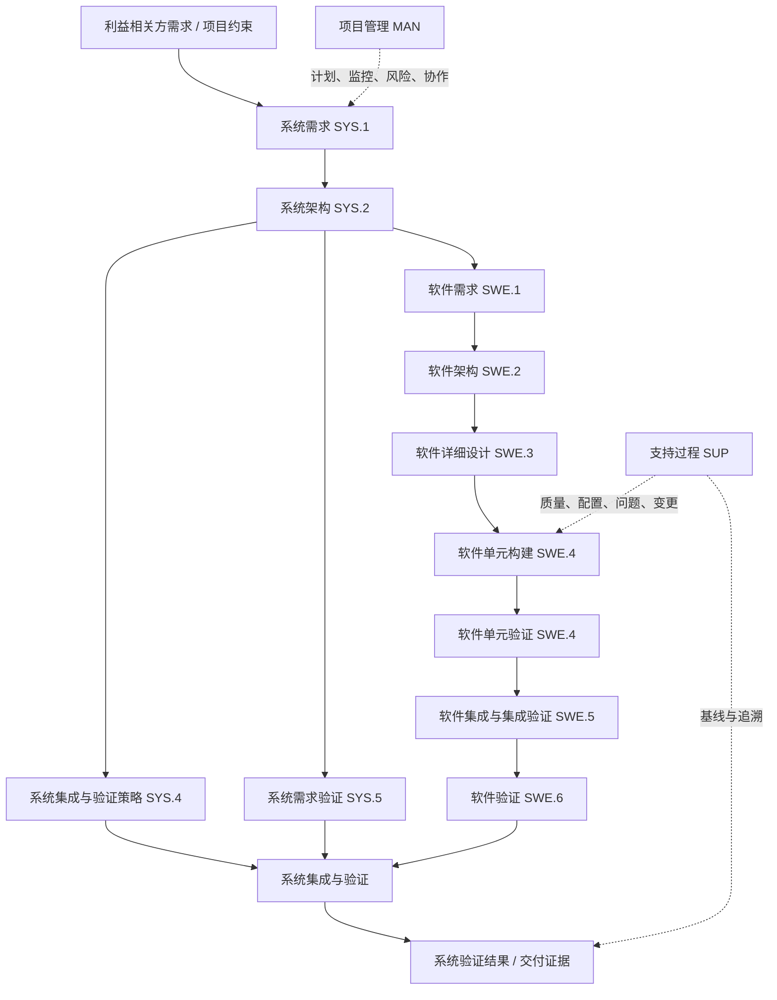

# Automotive SPICE（ASPICE）流程实践指南

> **定位**：面向汽车电子系统、嵌入式软件及控制器研发人员的工程实践指南。  
> **版本说明**：本文按 Automotive SPICE 过程思想组织，主要参考 ASPICE 4.0 的过程组概念进行学习性概括；正式项目必须以客户合同、项目裁剪结果及指定版本的 Process Assessment Model（PAM）/Process Reference Model（PRM）为准。本文不是标准原文，也不能替代正式评估。
>
> **状态：Draft / 学习与实践参考**  
> **建议归档位置**：`03-工程开发方法/ASPICE/`

## 1. 一页理解：ASPICE 到底解决什么问题？

ASPICE（Automotive SPICE）是汽车行业用于评价和改进开发过程能力的过程参考模型。它关注的不只是“有没有文档”，而是团队是否以可重复、可追溯、可验证的方式完成工程活动，并能提供客观证据。

核心逻辑可以概括为：

**需求明确 → 架构分解 → 详细设计 → 实现 → 分层验证 → 系统确认；全程由项目管理、质量保证、配置管理、问题解决和变更控制支撑。**

### 关键结论

1. **ASPICE 不是瀑布模型，也不强制某一种开发生命周期。** 敏捷、迭代、V 模型都可以采用，但工作产品、验证和追溯需要闭环。
2. **过程能力不等于产品质量。** 过程评估关注过程是否被执行、管理和制度化；产品是否安全、可靠、满足法规，还需相应的产品验证及其他标准。
3. **文档不是终点，证据链才是重点。** 需求、设计、代码、测试用例、测试结果、缺陷和变更之间应建立双向关联。
4. **不要为评估临时补文档。** 过程产物应来自真实开发活动，并保留版本、评审、批准、执行记录和问题关闭证据。
5. **先按项目范围确定适用过程。** 不要把所有过程清单机械套用到每个项目；裁剪理由、责任人和批准记录应明确。

## 2. 端到端开发流程图


下面是面向工程实践的简化主流程。左侧主要做分解与设计，右侧用相应层级的验证活动检查结果；每一层都要考虑需求覆盖、接口一致性、缺陷闭环和变更影响。



> 过程编号与过程名称会随 PAM 版本变化；上图是帮助理解层级关系的简化图，不应直接作为正式过程清单或评估检查表。特别是 SWE.4 等过程的具体名称和边界，执行时需对照项目采用版本核对。

## 3. 过程组怎么理解？

不同版本的过程参考模型会调整过程集合、名称和结构。实际使用时应先确认版本，再对照对应 PAM。学习时可按以下视角理解：

| 视角 | 主要关注 | 典型工程问题 |
|---|---|---|
| Acquisition / Supply（采购与供方） | 供需双方协作、交付和验收 | 供应商交付什么、何时交付、如何验收？ |
| System Engineering（系统工程） | 系统需求、系统架构、集成与验证 | 系统需求是否完整？软硬件接口是否一致？ |
| Software Engineering（软件工程） | 软件需求、架构、设计、实现、测试 | 需求是否能追踪到代码和测试结果？ |
| Hardware Engineering（硬件工程，视采用模型/范围而定） | 硬件需求、设计、验证及集成 | 硬件需求与设计验证是否形成闭环？ |
| Management（管理） | 项目计划、监控、风险、协作 | 计划是否可执行？偏差是否有措施和跟踪？ |
| Support（支持） | 质量保证、配置管理、问题解决、变更等 | 基线是否受控？问题是否追踪到关闭？ |
| Process Improvement / Reuse（改进与复用，依模型而定） | 过程改进、复用资产及其适用性 | 复用是否有准入标准、验证和维护责任？ |

**实践建议：** 项目启动时建立“过程适用性矩阵”，记录过程编号、适用性、裁剪理由、负责人、计划工作产品、评审点及客观证据位置。

## 4. 最重要的工程闭环：需求追溯

### 4.1 典型追溯链

```text
客户/利益相关方需求
    ↓ 分解与分配
系统需求
    ↓ 分解与分配
软件/硬件需求
    ↓ 实现映射
架构 / 详细设计 / 接口
    ↓ 实现
代码 / 电路 / 参数配置
    ↓ 验证
单元测试 → 集成测试 → 系统测试
    ↓ 结果与缺陷
测试报告 + 缺陷记录 + 回归证据
```

每条重要需求至少要能回答：
- 来源是什么？为何需要？由谁确认？
- 如何分解、分配给哪个系统/软件/硬件元素？
- 如何实现？对应哪些设计、接口、代码或配置？
- 如何验证？对应哪些测试用例、测试版本和结果？
- 发生变更后，影响分析、重新验证和批准在哪里？

### 4.2 示例：EVCC 充电通信超时处理

以下是示例需求，不代表任何标准条款或具体项目的正式要求：

| 项目 | 示例内容 |
|---|---|
| 需求 ID | EVCC-SW-REQ-042 |
| 需求陈述 | 当指定通信阶段在配置的超时时间内未收到有效响应时，EVCC 应进入定义的异常处理路径，并记录诊断信息。 |
| 验收条件 | 正常响应不触发超时；超时边界符合定义；异常路径可重复验证；诊断记录与状态迁移一致。 |
| 设计关联 | 通信状态机、定时器服务、异常处理模块、诊断接口 |
| 测试用例 | 正常响应、响应恰在边界前、边界处、边界后、重复/无效响应、计时器重入 |
| 证据 | 需求评审记录、设计评审、代码版本、测试脚本版本、日志、测试报告、缺陷闭环记录 |

**注意：** 超时时间、边界语义、状态迁移和安全状态必须来自项目需求/协议约束，不能由示例自行当成规范值。

## 5. 从需求到交付：各阶段输入、活动、输出和检查点

| 阶段 | 主要活动 | 典型工作产品/证据 | 评审重点 |
|---|---|---|---|
| 项目启动与策划 | 范围、计划、资源、风险、接口和交付物策划 | 项目计划、过程适用性矩阵、风险清单、沟通计划 | 责任是否明确？计划是否可测量？ |
| 系统需求 | 收集、分析、协商、分配和验证系统需求 | 系统需求规格、需求属性、评审记录、追溯关系 | 完整、无歧义、可验证、可追踪 |
| 系统架构 | 定义系统元素、接口、分配和设计约束 | 系统架构、接口定义、分配矩阵、架构评审记录 | 需求分配是否完整？接口是否一致？ |
| 软件需求 | 将系统分配需求转化为软件需求 | 软件需求规格、需求追溯矩阵、评审记录 | 每条需求是否必要、可验证、无冲突？ |
| 软件架构/详细设计 | 模块划分、接口、行为、数据和约束设计 | 软件架构、详细设计、状态机/时序图、接口说明 | 设计是否覆盖需求？接口/异常路径是否明确？ |
| 实现与单元验证 | 编码、静态检查、单元测试和缺陷修复 | 代码提交、静态分析结果、单元测试报告、评审记录 | 编码规则、边界条件、异常路径、可重复构建 |
| 集成与集成验证 | 集成组件，验证接口和交互 | 集成计划、接口测试、集成日志、缺陷记录 | 依赖顺序、接口兼容、错误处理、回归范围 |
| 软件/系统验证 | 按验证策略执行测试并总结结果 | 测试规范、用例、环境配置、结果报告、覆盖分析 | 需求覆盖、测试充分性、失败项处置 |
| 发布与交付 | 确认基线、版本、未关闭问题和交付包 | 发布说明、基线清单、已知问题、交付记录 | 交付内容可复现？证据是否对应同一版本？ |

以上是工程实践视角的典型映射，不是对任一版本所有 Base Practice 的完整逐条复述。

## 6. 项目管理与支持过程：不能等到最后补

### 项目管理（MAN）

建议项目周会至少检查：
- 计划活动与里程碑是否按期完成，偏差是否有量化说明；
- 需求、接口、软件、硬件、测试和供应商依赖是否有人负责；
- 风险是否有概率/影响、应对措施、责任人和截止日期；
- 资源、进度、范围或技术方案变化是否经过影响分析；
- 关键决策是否记录理由、参与者、批准状态和后续动作。

### 支持过程（SUP）

| 机制 | 最低实践要求 |
|---|---|
| 质量保证 | 独立检查过程和工作产品；发现项有责任人、期限、复核和关闭证据 |
| 配置管理 | 定义配置项、版本规则、基线、访问权限、变更记录和状态报告 |
| 问题解决 | 问题有唯一 ID、严重度、复现条件、根因/临时措施、责任人和关闭准则 |
| 变更管理 | 变更请求、影响分析、批准、实施、回归验证、基线更新形成闭环 |
| 追溯管理 | 需求与设计、实现、测试、缺陷和版本之间可双向查询 |
| 评审管理 | 有评审准入条件、参与角色、问题清单、结论和后续行动 |

## 7. 能力等级（Capability Level）与过程执行成熟度

ASPICE 的过程能力评价采用过程维度与能力维度相结合的思路。**不要将能力等级误解为产品质量分数，也不要简单理解为文档数量。** 具体属性、评级尺度和评分规则必须按所采用 PAM/评估模型执行。

通常学习中会遇到以下等级概念（以具体版本定义为准）：

- **CL 0 — Incomplete**：过程未实现或未能达到其目的。
- **CL 1 — Performed**：过程已执行并达到过程目的。
- **CL 2 — Managed**：过程在计划、监控、调整和工作产品管理方面得到管理。
- **CL 3 — Established**：过程以组织定义并制度化的方式执行。
- 更高等级的定义、适用条件及评估规则须以对应版本为准，不能将不同版本的等级模型混用。

从项目实践看，CL1 的关键是证明工程活动确实发生且达到目的；CL2 更强调有计划、有责任、有监控、工作产品受管理；CL3 更强调组织层面定义和部署标准过程。正式评分不能仅凭这段概括进行。

## 8. 评估前自查：常见失分风险

| 风险 | 常见表现 | 改进动作 |
|---|---|---|
| 需求不可验证 | “系统应快速、稳定、可靠”等模糊表述 | 明确触发条件、输入、输出、边界和可测量判据 |
| 追溯断链 | 需求有编号，但找不到设计或测试关联 | 使用唯一 ID 和自动化追溯矩阵，定期检查孤儿项 |
| 只留最终文档 | 无评审过程、版本历史或问题关闭记录 | 保留真实评审、提交、批准、测试与变更证据 |
| 测试报告不可复现 | 不清楚代码版本、环境、配置或数据集 | 测试报告记录版本、环境、脚本、配置、结果与偏差 |
| 变更无影响分析 | 改了需求/接口，但未更新测试或追溯 | 变更单关联受影响项、重新验证和批准 |
| 缺陷关闭无证据 | 只写“已修复”，没有回归结果 | 记录根因、修复版本、回归范围、结果和复核人 |
| 配置基线不清 | 文档、代码、测试报告对应不同版本 | 建立发布基线清单并核对所有证据版本 |
| QA 不独立 | 项目团队自查后直接标记合格 | 定义质量保证角色、检查规则、问题升级与复核机制 |
| 机械堆文档 | 模板齐全但与实际活动不一致 | 精简模板，围绕决策、追溯、验证和客观证据组织工作产品 |

## 9. 可直接落地的最小实践包

建议从以下 10 项开始，不必一开始就建立庞大文档体系：

1. 项目范围与过程适用性矩阵；
2. 项目计划、角色责任表和里程碑；
3. 系统/软件需求规格及需求属性规则；
4. 需求双向追溯矩阵；
5. 系统/软件架构和关键接口定义；
6. 设计评审检查表与问题清单；
7. 验证策略、测试用例、环境与版本记录；
8. 测试报告、覆盖分析和缺陷闭环记录；
9. 配置项清单、基线和变更记录；
10. QA 检查计划、发现项及关闭证据。

这些是推荐的工程最小集，不代表每个项目都只需这些工作产品，也不代表其一一对应某个正式过程的全部成果。

## 10. 以 EVCC 为例的落地节奏

### 第 1 周：建骨架
- 明确项目范围、采用的 ASPICE 版本、评估范围和客户交付要求；
- 建立过程适用性矩阵、角色责任表和项目计划；
- 统一需求 ID、设计 ID、测试用例 ID、缺陷 ID 和版本命名规则。

### 第 2 周：打通追溯
- 选取一个真实功能（例如通信超时处理）做端到端样例；
- 从系统需求追踪到软件需求、状态机、代码提交、测试用例和测试结果；
- 检查是否存在无来源需求、无验证需求、无需求关联测试。

### 第 3 周：建立验证和变更闭环
- 固化测试环境、测试数据、脚本和软件版本记录；
- 选择一次真实需求/接口变更，执行影响分析、批准、实施和回归；
- 检查缺陷是否有复现条件、根因、修复版本和关闭证据。

### 第 4 周：做一次内部过程检查
- 依据项目适用的 PAM/评估模型和客户要求做差距分析；
- 将问题按严重程度、风险、责任人和完成日期排序；
- 先修复追溯断链、基线不一致、验证证据缺失等系统性问题。

## 11. 与功能安全、FMEA、测试和项目管理如何协同？

- **ASPICE**：关注工程过程是否被有效执行、管理并有客观证据。
- **ISO 26262 功能安全**：关注道路车辆电气/电子系统的功能安全生命周期和安全论证。
- **FMEA**：分析潜在失效模式、影响、原因和风险控制措施。
- **DV/PV、软件测试、HIL**：提供设计/产品验证证据；测试层级和覆盖应由需求、风险及验证策略驱动。
- **项目管理**：协调范围、进度、资源、风险、依赖和交付。
- **配置管理与变更管理**：保证分析、设计、代码、测试结果对应正确且受控的版本。

这些方法互补但不互相替代。例如，FMEA 中的风险控制措施应转化为可追溯的需求或设计约束，并通过测试/分析验证；测试发现的问题进入缺陷流程，修复后更新基线并执行影响分析。

## 12. 评估准备检查清单

- [ ] 已确认客户要求的 ASPICE 版本、评估范围和项目边界
- [ ] 已识别适用过程并记录裁剪理由及批准
- [ ] 每个关键过程有负责人、计划和可查证的工作产品
- [ ] 需求具备唯一标识、状态、来源、验收标准和追溯关系
- [ ] 架构与接口覆盖需求分配，关键设计已评审
- [ ] 测试用例可追溯到需求，测试结果对应明确的软件/系统版本
- [ ] 未通过测试、偏差和已知问题有处置决定及批准
- [ ] 配置项、基线、变更记录和发布包一致
- [ ] 问题有责任人、截止日期、根因/措施和关闭证据
- [ ] QA 检查记录及发现项复核可查
- [ ] 证据来自真实项目活动，能说明“谁、何时、针对哪个版本、做了什么、结果如何”

## 13. 术语速查

| 术语 | 含义 |
|---|---|
| PRM | Process Reference Model，过程参考模型 |
| PAM | Process Assessment Model，过程评估模型 |
| BP | Base Practice，基本实践 |
| GP | Generic Practice，通用实践（术语和结构需按模型版本核对） |
| Work Product | 工作产品，如需求规格、架构、测试报告、配置记录 |
| Traceability | 追溯性，工作产品之间可建立并维护关联 |
| Baseline | 基线，经正式确认并受变更控制的配置状态 |
| Objective Evidence | 客观证据，用于证明活动、结果及管理状态的可核查信息 |
| Capability Level | 过程能力等级，按指定评估模型评价过程能力 |

## 14. 参考资料与版本控制

- Automotive SPICE 官方门户：<https://automotivespice.com/>
- Automotive SPICE for Cybersecurity 官方发布资料（用于理解过程评估模型的二维结构，不等同于完整通用 PAM）：<https://automotivespice.com/fileadmin/software-download/AutomotiveSPICE_for_Cybersecurity.pdf>
- 本文最后整理：2026-10-12
- 版本策略：客户合同/评估要求优先；模型升级时先做差异分析，再更新过程映射、模板与检查表。
- 使用限制：本文为工程学习与实施参考；不复制标准全文，不将概括性示例作为正式合规要求。

---
**一句话记忆：** ASPICE 的核心不是“把文件写齐”，而是把需求、设计、实现、验证、变更和质量管理连接成可追溯、可复现、可审查的工程闭环。
