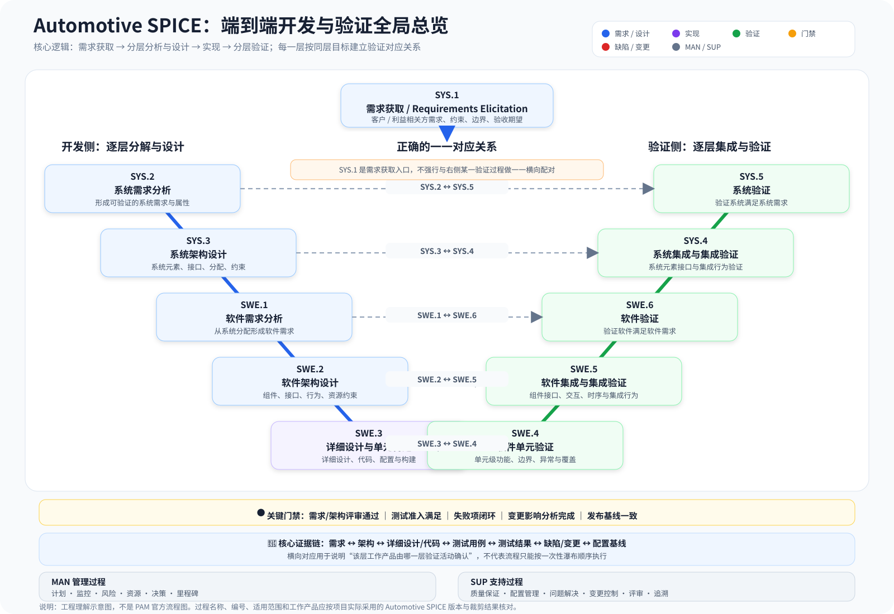

# ASPICE（Automotive SPICE）

过程参考模型、SYS/SWE/HWE、SUP/MAN、追溯与能力评估。

**图示说明：** 左侧表示需求分解与架构/详细设计，底部表示实现，右侧表示单元、集成、系统层级的验证与确认。管理过程（MAN）和支持过程（SUP）为开发活动提供项目治理、质量保证、配置管理、问题解决与客观证据。

> **适用边界：** 该图为便于学习的概念示意图，不是 Automotive SPICE PAM 官方流程图。具体过程名称、过程属性、成果及能力等级要求，应以项目采用的 PAM 版本和评估范围为准。

## 归档规则

- 以本主题为主归属，跨主题内容通过相对链接引用，不重复复制。
- 技术结论记录来源、版本、假设和验证状态。
- AI 生成内容默认标记为 Draft。
- SVG 技术图可直接以文本源文件提交到 GitHub，并通过相对路径嵌入 Markdown；无需本地图片中转。
