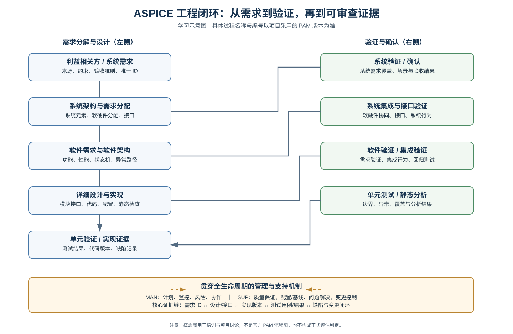

# ASPICE（Automotive SPICE）

面向汽车电子系统、嵌入式软件与控制器研发的 ASPICE 学习和落地入口。

## 核心资料

- [ASPICE 流程实践指南](ASPICE流程实践指南.md)：端到端流程、过程组、需求追溯、工作产品、能力等级、常见失分点、EVCC 实践节奏和评估自查清单。
- [ASPICE 开发 V 模型示意图](images/aspice-v-model.svg)
- [ASPICE 工程闭环总览图](images/aspice-engineering-loop.svg)

## 实践重点

1. 先确认项目采用的 PAM/PRM 版本、客户要求和评估范围。
2. 建立过程适用性矩阵、项目计划、角色责任和风险清单。
3. 用真实功能打通需求 → 架构/设计 → 实现 → 测试 → 缺陷/变更的双向追溯。
4. 通过配置管理、质量保证和问题解决机制保持证据一致、可复现、可审查。
5. 将 AI 生成内容作为学习草稿，经过标准版本核对和工程审核后再纳入项目受控过程。

> 图示和指南属于学习/实践参考，不是 Automotive SPICE PAM 官方流程图或标准原文。具体过程编号、名称、过程属性、工作产品及能力等级要求，以项目采用的正式模型和评估范围为准。

## 归档规则

- 以本目录作为 ASPICE 主归属；跨主题内容通过相对链接引用，不重复复制。
- 技术结论记录来源、版本、假设和验证状态。
- AI 生成内容默认标记为 Draft。
- SVG 图形直接以源码归档，并从 Markdown 以相对路径引用；无需本地图片中转。
