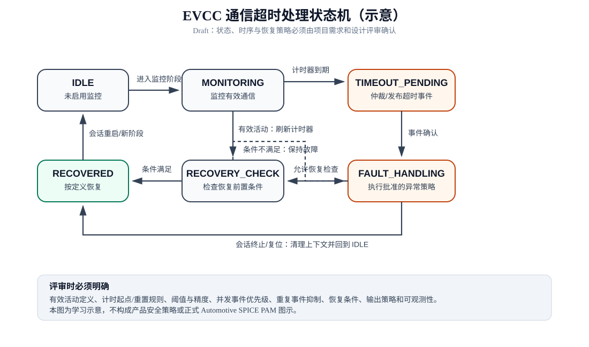

# 软件状态机与架构示例

> Draft。下述组件与状态为说明用途的逻辑模型，不代表特定 EVCC 产品架构或已批准的安全策略。

## 1. 建议的逻辑分层

| 组件 | 职责 | 关键接口/证据 |
|---|---|---|
| 通信适配层 | 接收协议消息，检查格式与基本有效性 | RxMessage、协议状态、接口定义 |
| 通信监控器 | 按项目定义识别有效活动并管理计时器 | ActivityIndication、TimerExpired |
| 充电状态管理器 | 按状态机处理超时、恢复和会话状态 | TimeoutEvent、RecoveryEvent |
| 诊断管理器 | 记录故障状态、计数与诊断事件 | DTC/事件接口（若适用） |
| 输出/安全控制接口 | 执行经系统分析批准的输出策略 | 控制请求、反馈与监测 |

组件之间的接口应定义数据类型、单位、有效范围、时序、调用上下文、并发约束、错误处理和版本兼容性。

## 2. 状态模型

- **IDLE**：尚未进入需要监控通信的阶段。
- **MONITORING**：通信监控已启用，等待符合定义的有效活动。
- **TIMEOUT_PENDING**：达到超时条件，执行一致性检查/事件仲裁（若架构需要）。
- **FAULT_HANDLING**：执行批准的异常处理策略并记录诊断。
- **RECOVERY_CHECK**：检查通信恢复、协议状态及其他恢复前置条件。
- **RECOVERED**：恢复条件满足，按批准流程重新进入监控或正常流程。

状态名仅用于示意。实际项目可合并或拆分状态，但必须保证行为可验证、异常路径完整。

## 3. 状态转换检查重点

| 当前状态 | 事件/条件 | 预期动作 | 下一状态 |
|---|---|---|---|
| IDLE | 进入需监控的协议阶段 | 初始化计时器与监控上下文 | MONITORING |
| MONITORING | 符合定义的有效活动 | 按规则重置/刷新计时器 | MONITORING |
| MONITORING | 计时器到期且无有效活动 | 发布超时事件，防止重复触发 | TIMEOUT_PENDING |
| TIMEOUT_PENDING | 事件确认/策略选择完成 | 执行批准的故障策略 | FAULT_HANDLING |
| FAULT_HANDLING | 满足恢复检查入口条件 | 检查协议与系统恢复前置条件 | RECOVERY_CHECK |
| RECOVERY_CHECK | 全部恢复条件满足 | 清除/更新状态并记录恢复 | RECOVERED |
| RECOVERY_CHECK | 任一恢复条件不满足 | 保持故障或重新开始规定等待 | FAULT_HANDLING |
| 任意监控状态 | 会话终止/复位 | 取消计时器并清理上下文 | IDLE |

## 4. 关键设计问题

1. **计时起点**：从会话阶段切换、消息发送、消息接收，还是最后一次有效活动开始计时？
2. **有效活动**：无效帧、重复帧、旧序号、格式正确但语义错误的消息是否重置计时器？
3. **阈值与精度**：需求阈值如何考虑任务周期、时钟误差、网络抖动与处理延迟？
4. **并发与竞态**：TimerExpired 与 RxMessage 同时发生时的优先级和确定性如何定义？
5. **重复触发**：故障已锁存时，是否抑制重复事件、累加计数或更新最后发生时间？
6. **恢复与复位**：通信恢复是否足够，还是还需协议状态一致、对端确认或受控复位？
7. **可观测性**：测试如何观察计时器状态、事件、状态迁移和输出动作？
8. **降级策略**：异常处理由系统安全分析、协议要求和产品策略共同确定，不能凭示例猜测。

## 5. 设计评审证据

- 状态图与状态转换表一致。
- 每个状态和转换有需求依据。
- 所有非法事件、重复事件、边界条件和会话终止路径已定义。
- 接口契约覆盖时序、错误码、数据有效性、并发与资源约束。
- 设计到软件单元、集成测试和系统测试有双向追溯。
- 关键决策有评审记录，未决问题有责任人和关闭期限。

