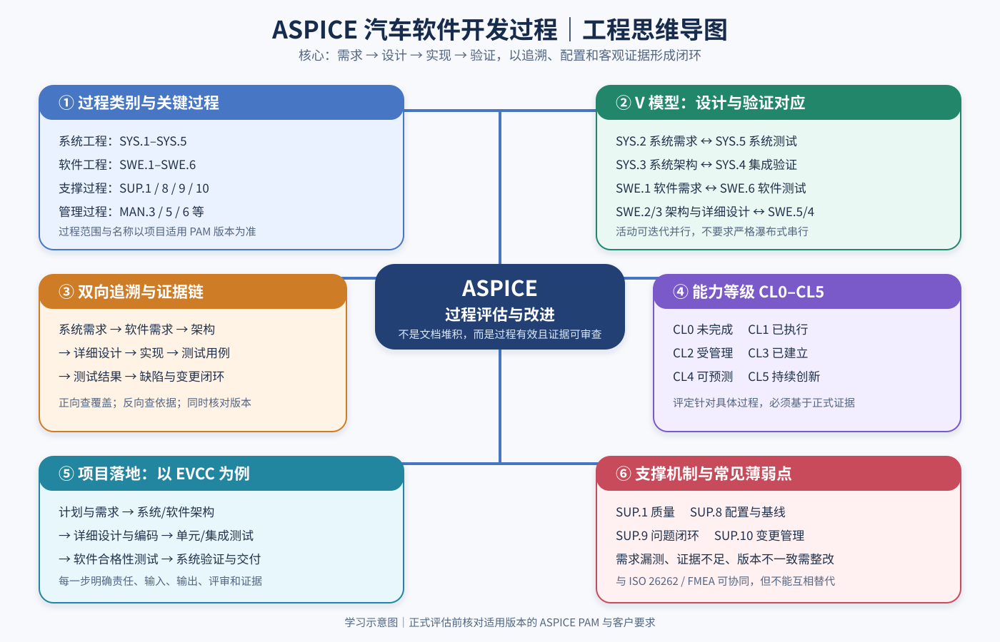

# Automotive SPICE（ASPICE）流程详解与工程实践

- **文档 ID**：ASP-001
- **状态**：Draft / 工程学习资料
- **适用场景**：汽车电子控制器软件开发，例如 EVCC、SECC、OBC、DCDC、BMS
- **版本注意**：过程编号、名称、过程属性和工作产品要求以项目约定的 ASPICE PAM 版本为准。本文用于工程理解，不构成正式评估结论或符合性声明。

## ASPICE 全流程思维导图

**阅读提示：** 本图用于快速建立过程类别、V 模型、双向追溯、能力等级和项目落地之间的整体关系。它是学习示意图，不替代适用版本的 ASPICE PAM、客户要求或正式评估证据。

## 1. 一句话理解 ASPICE

Automotive SPICE 是汽车行业用于过程评估和改进的参考模型。它关注的不只是“有没有文档”，而是开发过程是否被有效执行、管理、验证，并且有客观证据。

理解 ASPICE 的三个核心问题：

1. **开发什么？** 需求、架构、详细设计、代码和测试。
2. **如何证明正确？** 需求双向追溯、评审、验证、缺陷闭环。
3. **如何证明过程受控？** 项目计划、配置管理、变更管理、质量保证和度量。

> 核心原则：让需求、设计、实现、验证和变更形成一条可审查的工程证据链。

## 2. ASPICE 整体流程

典型系统与软件工程主线可概括为：

客户/利益相关方需求
→ 系统需求分析（SYS.2）
→ 系统架构设计（SYS.3）
→ 软件需求分析（SWE.1）
→ 软件架构设计（SWE.2）
→ 软件详细设计与单元构建（SWE.3）
→ 软件单元验证（SWE.4）
→ 软件组件与集成验证（SWE.5）
→ 软件合格性测试（SWE.6）
→ 系统集成与集成验证（SYS.4）
→ 系统合格性测试（SYS.5）
→ 发布和交付。

这是便于理解的简化视图，不是强制的串行瀑布流程。需求分析、测试设计、风险分析、评审和集成活动可以并行开展；项目也可以采用迭代、增量或持续集成方式。

### 2.1 主要过程组

| 过程组 | 重点过程 | 解决的问题 |
|---|---|---|
| 系统工程 | SYS.1–SYS.5 | 需求从哪里来，系统如何分解、集成和验证 |
| 软件工程 | SWE.1–SWE.6 | 软件需求如何变成设计、代码和测试证据 |
| 管理过程 | MAN.3、MAN.5、MAN.6 等 | 项目如何计划、监控、管理风险和度量 |
| 支撑过程 | SUP.1、SUP.8、SUP.9、SUP.10 等 | 如何保证质量、配置一致、问题闭环和变更受控 |
| 其他过程 | 依项目范围而定 | 例如采购、发布、复用、验证、过程改进或机器学习数据管理 |

## 3. 关键过程编号

正式评估时应核对适用版本的过程名称和要求。以下为常见过程的工程化解释。

### 3.1 系统工程 SYS

| 编号 | 常见英文名称 | 核心任务 |
|---|---|---|
| SYS.1 | Requirements Elicitation | 获取并澄清利益相关方需求 |
| SYS.2 | System Requirements Analysis | 将利益相关方要求转化为可分析、可验证的系统需求 |
| SYS.3 | System Architectural Design | 定义系统元素、职责、接口及需求分配 |
| SYS.4 | System Integration and Integration Verification | 集成系统元素，验证元素间接口与交互 |
| SYS.5 | System Qualification Test | 验证系统是否满足系统需求 |

### 3.2 软件工程 SWE

| 编号 | 常见英文名称 | 核心任务 | 典型工作产品 |
|---|---|---|---|
| SWE.1 | Software Requirements Analysis | 定义软件功能、性能、接口、异常行为及约束 | 软件需求规格说明、需求分析记录 |
| SWE.2 | Software Architectural Design | 定义软件组件、接口、数据流和职责分配 | 软件架构设计、组件接口定义 |
| SWE.3 | Software Detailed Design and Unit Construction | 细化单元设计并完成软件实现 | 详细设计、源代码、构建配置 |
| SWE.4 | Software Unit Verification | 验证软件单元是否符合详细设计 | 单元测试用例、结果、覆盖率分析 |
| SWE.5 | Software Component Verification and Integration Verification | 验证组件及集成后的交互 | 组件/集成测试用例、结果、缺陷记录 |
| SWE.6 | Software Qualification Test | 验证集成软件是否满足软件需求 | 软件合格性测试规范、结果和报告 |

### 3.3 支撑与管理过程

| 编号 | 过程 | 工程作用 |
|---|---|---|
| MAN.3 | Project Management | 计划、资源、进度、职责和项目状态监控 |
| MAN.5 | Risk Management | 识别、分析、处理和跟踪风险 |
| MAN.6 | Measurement | 定义度量项、采集数据、分析趋势和偏差 |
| SUP.1 | Quality Assurance | 检查过程与工作产品是否符合约定要求 |
| SUP.8 | Configuration Management | 管理版本、基线、配置项及交付内容 |
| SUP.9 | Problem Resolution Management | 记录、分析、跟踪和关闭问题 |
| SUP.10 | Change Request Management | 评估、批准、实施并验证变更 |

不同版本的过程集合会变化。ASPICE 4.0 还包含机器学习数据管理等专门过程；并非每个传统控制器项目都需要应用所有过程。项目应根据适用 PAM、客户要求、项目范围和正式裁剪规则确定评估范围。

## 4. V 模型：设计层级与验证层级对应

V 模型强调：每一层需求或设计都应有适当的验证策略和证据。

| 定义/设计侧 | 对应的验证侧（概念映射） |
|---|---|
| 系统需求（SYS.2） | 系统合格性测试（SYS.5） |
| 系统架构（SYS.3） | 系统集成与集成验证（SYS.4） |
| 软件需求（SWE.1） | 软件合格性测试（SWE.6） |
| 软件架构（SWE.2） | 软件组件与集成验证（SWE.5） |
| 软件详细设计/单元（SWE.3） | 软件单元验证（SWE.4） |

这是一种便于理解的映射，并不意味着所有活动必须严格串行。具体测试分工、过程名称和工作产品要求以项目适用版本为准。

### Verification 与 Validation 的区别

- **Verification（验证）**：检查工作产品是否满足规定的输入、设计或要求，例如代码是否符合详细设计。
- **Validation（确认）**：检查产品在预期使用场景中是否满足用户实际需要。

不要把所有测试笼统地视为同一种活动；应明确测试对象、验证依据、预期结果和适用层级。

## 5. 以 EVCC 为例：项目开发阶段拆解

### 阶段 0：项目启动与计划

**目的：** 先明确范围、计划、角色、资源、质量策略和配置规则。

主要活动：
- 明确项目边界、交付物、客户要求和外部依赖。
- 制定里程碑、工作分解、责任分配和资源计划。
- 制定需求、设计、编码、评审、测试和发布规范。
- 建立仓库、版本、基线和配置项管理规则。
- 识别 PLC 兼容性、证书配置、供应商交付等风险。
- 制定质量保证和项目度量计划。

典型工作产品：项目计划、里程碑计划、职责矩阵、风险登记册、质量保证计划、配置管理计划、项目状态报告。

**评估关注：** 计划是否真实用于管理项目，偏差是否被发现、分析和处理，而不是只有一份计划文档。

### 阶段 1：需求获取与系统需求分析（SYS.1 / SYS.2）

把客户的高层要求转化为明确、可实现、可验证的系统需求。

例如，“车辆支持 CCS2 直流充电”还需要拆解为通信建立、参数协商、充电控制、异常处理、接口和兼容性等可验证要求。

需求检查重点：
- 唯一标识、来源、版本、优先级和状态明确。
- 内容清晰、必要、可行且可验证。
- 需求之间没有未处理的冲突、重复和遗漏。
- 正常、异常、边界、超时和恢复行为得到考虑。
- 验证方法和验收条件明确。

典型工作产品：利益相关方需求记录、系统需求规格说明、需求属性、需求评审记录和验证策略。

### 阶段 2：系统架构设计（SYS.3）

明确系统元素及其职责，并把系统需求分配给相关元素。

EVCC 系统可能涉及：
- EVCC 控制器及其软件。
- PLC 通信硬件与协议栈。
- CP/PP 信号采集和连接检测。
- BMS、VCU、OBC 或其他车辆控制器。
- 充电桩 SECC。
- 车辆网络、诊断及电源管理。

重点检查：
1. 系统边界与元素职责清楚。
2. 系统需求分配到合适的元素。
3. 接口的数据类型、单位、时序、有效性和错误处理明确。
4. 元素之间的依赖和交互风险已分析。
5. 架构能够支持性能、可靠性、诊断和适用的安全约束。

典型工作产品：系统架构图、接口定义、系统需求分配关系、架构分析及评审记录。

### 阶段 3：软件需求分析（SWE.1）

把分配给软件的系统要求进一步转化为软件可实现、可验证的行为定义。

例如，针对“异常时终止充电会话”，软件需求应明确：
- 触发条件和适用状态。
- 输入信号、报文和定时器条件。
- 状态迁移与输出行为。
- 超时、无效数据、通信中断时的处理。
- 故障记录、通知和恢复策略。
- 对应的验证方法和验收条件。

**关键标准：** 开发人员能据此实现，测试人员能据此设计可重复的测试。

### 阶段 4：软件架构设计（SWE.2）

将软件需求分配到软件组件，并定义组件职责、接口和交互。

以 AUTOSAR Classic EVCC 为例，软件可能包括充电业务状态机、会话管理、协议服务、诊断、网络通信、硬件抽象及驱动接口。具体分层取决于项目架构，不是 ASPICE 强制规定的唯一方案。

评审重点：
- 每条软件需求是否有合理的组件分配。
- 组件接口是否定义输入、输出、单位、时序、有效性及错误处理。
- 数据所有权、调用关系、状态同步和资源约束是否清楚。
- 架构是否支持需求中的异常行为、性能和其他约束。

典型工作产品：软件架构设计、组件接口定义、需求分配关系、架构评审记录。

### 阶段 5：软件详细设计与实现（SWE.3）

把架构组件细化为可实现的单元，并完成编码。

详细设计应明确：
- 单元职责、输入输出和接口契约。
- 算法、状态迁移、条件分支和边界行为。
- 定时器启停/复位、错误处理和返回值。
- 与其他单元的依赖。
- 对应的单元验证方法。

实现阶段包括编码、代码评审、静态检查和必要的构建验证。SWE.3 不只是写代码，还要确保实现与详细设计之间的一致性。

典型工作产品：详细设计、源代码、构建配置、代码评审记录、静态分析结果及问题处置记录。

### 阶段 6：软件单元验证（SWE.4）

**目标：** 证明软件单元符合详细设计。

常见活动：
1. 设计具有明确预期结果的单元测试。
2. 覆盖正常输入、边界值、异常输入和错误分支。
3. 执行测试并保存实际结果。
4. 按项目要求分析语句、分支或其他覆盖率数据。
5. 记录失败用例、缺陷修复和回归结果。

例如，对充电参数有效性检查函数测试合法值、越界值、无效标志、缺失数据和边界条件。代码被执行过并不等于行为已被正确验证。

### 阶段 7：软件组件与集成验证（SWE.5）

**目标：** 证明组件之间的接口交互和集成行为正确。

EVCC 典型场景：
- 状态机与协议栈之间的交互。
- EVCC 与 BMS 的参数交换。
- 通信超时与故障管理模块的协同。
- 网络通信与诊断模块的状态及资源交互。

重点验证接口参数、数据类型、单位、调用顺序、时序、状态同步、错误传播和恢复行为。

典型工作产品：集成测试策略、测试用例、执行结果、缺陷记录和集成验证报告。

### 阶段 8：软件合格性测试（SWE.6）

**目标：** 证明集成软件满足软件需求，而不是仅仅证明代码按预期运行。

测试可包括：
- 正常充电会话建立和参数协商。
- 通信中断、报文异常、超时和恢复。
- 充电停止及异常退出。
- 项目定义的协议和配置组合。
- 软件需求规定的性能、时序和诊断行为。

典型工作产品：软件合格性测试规范、测试用例、执行结果、需求覆盖记录和测试报告。

### 阶段 9：系统集成、系统测试与交付（SYS.4 / SYS.5）

将软件与目标硬件、车辆网络、BMS/VCU、SECC 及其他系统元素结合，验证端到端行为。

重点包括：
- 真实控制器和目标硬件上的集成。
- 外部接口及系统交互。
- 实车或台架端到端充电场景。
- 项目要求的兼容性、异常恢复和系统性能测试。
- 发布版本、配置项、测试报告、未解决问题和交付证据的一致性。

阶段划分是项目组织方式，不是 ASPICE 强制要求的九个连续阶段。活动可以并行和迭代。

## 6. 核心机制：需求双向追溯

双向追溯是需求、设计、实现和验证之间的关联关系。它用于检查需求是否被完整实现和验证，也用于发现没有合理需求或设计依据的实现。

### 6.1 典型追溯链

系统需求
→ 系统架构/需求分配
→ 软件需求
→ 软件架构
→ 软件详细设计
→ 软件单元/实现
→ 单元测试、集成测试、软件合格性测试
→ 测试结果及缺陷闭环。

实际项目可能是一对多或多对多关系，不要求每条需求只对应一个设计元素或测试用例。

### 6.2 正向与反向追溯

- **正向追溯：** 从需求出发，能找到相关设计、实现和测试证据。
- **反向追溯：** 从设计、代码或测试出发，能找到合理的需求、设计或验证依据。

如果一条软件需求没有测试用例，应检查验证覆盖缺口；如果代码没有需求或设计依据，应分析它是否源于遗漏需求、未批准变更或不必要实现。

### 6.3 示例追溯矩阵

| 需求 ID | 设计 ID | 软件单元 | 测试用例 | 状态 |
|---|---|---|---|---|
| SYS-REQ-001 | SYS-ARC-001 | — | SYS-TC-001 | 已验证（示例） |
| SWE-REQ-010 | SWE-ARC-003 | EVCC_SM.c | SWE-TC-010 | 已通过（示例） |
| SWE-REQ-011 | SWE-DD-008 | EVCC_Timer.c | SWE-TC-011、012 | 已通过（示例） |
| SWE-REQ-012 | 待补充 | 待分配 | 无 | 存在缺口（示例） |

追溯矩阵不只是“链接存在”检查，还应检查链接正确性、覆盖情况、版本一致性和变更影响。

## 7. 能力等级 CL0–CL5

能力等级用于评价特定过程的过程能力，不应简单理解为整个项目或组织只有一个总等级。

| 等级 | 名称 | 核心含义 |
|---|---|---|
| CL0 | Incomplete | 过程未实现，或未达到过程目的 |
| CL1 | Performed | 过程目的已实现并取得预期结果 |
| CL2 | Managed | 过程在计划、监控和管理下执行 |
| CL3 | Established | 过程基于组织定义的标准过程建立和执行 |
| CL4 | Predictable | 过程在量化管理下运行，具备可预测性 |
| CL5 | Innovating | 通过持续改进应对变化并提升过程能力 |

### CL1、CL2、CL3 的差异

- **CL1：** 活动实际执行，工作产品能证明预期结果。
- **CL2：** 除执行外，还要有计划、责任、资源、监控及问题管理。
- **CL3：** 项目过程基于组织定义的标准过程，并根据项目情况进行合理裁剪和部署。

等级判断必须依据正式评估模型及证据，不能凭文档数量或本清单自行判定。

## 8. 评估自查清单

### 需求工程
- [ ] 需求有唯一标识、来源、版本和可验证条件。
- [ ] 上下游追溯关系明确。
- [ ] 需求评审问题有记录和闭环。

### 架构与设计
- [ ] 系统和软件架构职责清楚。
- [ ] 接口、数据流和控制流有明确描述。
- [ ] 需求分配、设计评审和问题处理证据完整。

### 实现与测试
- [ ] 详细设计与代码实现保持一致。
- [ ] 测试用例有明确验证目标和预期结果。
- [ ] 测试版本、环境、输入、结果和异常记录完整。
- [ ] 缺陷修复和回归验证可追踪。

### 配置与变更
- [ ] 需求、代码、测试用例和报告版本可识别。
- [ ] 变更经过影响分析、批准、实施及验证。
- [ ] 发布基线与交付内容一致。

### 项目管理与质量
- [ ] 项目计划、进度、风险及度量数据有记录。
- [ ] 质量保证活动能检查过程与工作产品。
- [ ] 问题有责任人、处理措施、截止日期和关闭证据。

这是一份工程自查清单，不是官方完整评估问卷，也不能直接用于判定能力等级。

## 9. 常见评估薄弱点与整改方向

| 薄弱点 | 常见根因 | 改进方向 |
|---|---|---|
| 有需求文档，但测试覆盖不完整 | 需求到测试追溯缺失 | 建立需求覆盖检查和缺口分析 |
| 测试通过，但执行证据不足 | 只保留结论，没有完整记录 | 保存版本、环境、输入、实际结果和异常 |
| 代码已修改，设计未更新 | 变更影响分析不足 | 检查需求、架构、设计、代码和测试的联动影响 |
| 评审记录只有签名 | 缺少发现项和问题闭环 | 记录问题、责任人、措施、期限和复核证据 |
| 只测正常路径 | 边界、异常和恢复场景不足 | 根据需求和风险完善测试设计 |
| 项目结束才补文档 | 过程与实际研发脱节 | 将工作产品维护融入日常开发活动 |
| 版本无法复现 | 配置和基线管理不充分 | 建立受控基线及发布清单 |

## 10. 与 ISO 26262、FMEA 和测试的关系

| 方法/标准 | 主要回答的问题 |
|---|---|
| ASPICE | 开发过程是否系统化、受控且有证据 |
| ISO 26262 | 道路车辆功能安全生命周期和安全相关要求如何管理 |
| FMEA | 潜在失效模式、影响、原因及控制措施是什么 |
| 软件测试 | 实现是否满足规定要求，特定场景下行为是否正确 |
| 配置与变更管理 | 变更后的设计、实现、验证和发布是否保持一致 |

EVCC 示例：CP 信号异常可能导致充电流程无法正常推进。FMEA 可分析失效影响、原因和控制措施；适用时由功能安全活动确定安全要求；ASPICE 过程确保要求被定义、分配、实现和验证；测试验证规定行为；配置和变更管理保证修复后的版本、测试证据与交付内容一致。

ASPICE 与 ISO 26262 的目标和评价方式不同，可以共享工作产品和追溯关系，但不能相互替代。并非所有 EVCC 功能都自动属于功能安全范围，应由项目安全分析和适用要求确定。

## 11. 建议学习和落地顺序

1. 掌握 SYS.2、SYS.3、SWE.1–SWE.6 的输入、活动和输出。
2. 选一条真实需求，建立需求—架构—设计—代码—测试—结果的追溯链。
3. 学习 SUP.1、SUP.8、SUP.9、SUP.10，重点掌握质量保证、配置、问题和变更管理。
4. 将 FMEA 和适用的功能安全分析结果转化为可追溯、可验证的工程要求。
5. 模拟项目评估：抽查需求、工作产品、测试证据、问题闭环和版本一致性。

## 12. 参考资料与适用性声明

- VDA QMC：Automotive SPICE Process Assessment Model（PAM）及官方出版物。
- 项目实际使用的 ASPICE PAM 版本、评估范围、组织过程和裁剪规则。
- 客户质量要求、项目开发流程及工作产品模板。

正式评估前，核对适用 PAM 的版本、过程属性、工作产品特征和客户要求。本文为工程实践性概述；示例 ID、测试场景和架构均为说明用途，不能替代标准原文、项目规范或正式评估。
