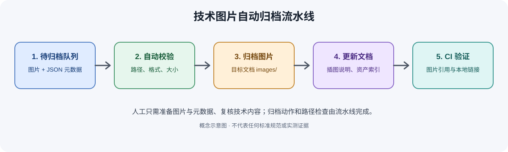

# AI 协作与自动归档规范

## 目标

让 ChatGPT、代码助手或人工维护者能够按一致规则，将技术问答、技术图解、代码、PDF 和测试资料沉淀为可检索、可追溯、可持续维护的知识资产。

## 标准工作流

1. **识别内容类型**：知识说明、标准摘录、代码、测试记录、图片/图解、专利构思、工程案例或技术情报。
2. **确定主目录和标签**：参考 `知识分类与目录规划.md`，一个资产只保留一个主归属。
3. **生成配套文件**：优先 Markdown 作为入口；原始 PDF、代码、图片、数据放在同主题资产目录或条目附件目录。
4. **记录来源和状态**：标注来源 URL/文件、版本/日期、页码/章节、生成方式、审核状态。
5. **检查隐私与许可**：禁止提交密钥、访问令牌、个人数据和未经授权的公司/客户机密。
6. **建立链接**：索引链接到说明文档，说明文档链接到图像、源文件和证据。
7. **验证**：检查文件是否存在、相对链接是否正确、图像是否可渲染、内容是否有未验证声明。
8. **提交变更**：使用清晰的 commit message；对大批量改动先在分支中验证。

## AI 输出状态

- `Draft`：AI 或人工初稿，未经完整核实。
- `In Review`：等待技术审核。
- `Approved`：来源和关键结论已由人工核验。
- `Deprecated`：已过时，但保留作为历史记录。

AI 不得将自己生成的内容描述为已通过工程验证。对标准条款、法规、功能安全、电路设计和测试结论，必须标注具体证据或明确列出待验证项。

## 文件命名

- Markdown：`主题-具体问题.md`，使用小写英文 kebab-case 或稳定的中文标题均可，但同一目录保持一致。
- 技术图片：`主题-子主题-图号-版本.png`，如 `evcc-dc-v2h-sequence-v1.png`。
- 源图：优先保留 `.svg`、`.drawio`、`.pptx` 或可复现的绘图脚本。
- 测试证据：文件名包含产品/版本/测试项/日期；避免在文件名中包含客户机密。

## 自动化建议

- 索引生成：扫描 Markdown 标题、标签、状态和相对链接，更新 `00-index/INDEX.md`。
- 链接检查：检测失效相对链接和缺失图片。
- 图片检查：检测 Markdown 图片引用是否指向仓库内存在的文件。
- 内容检查：检测未标来源的标准结论、空模板、重复标题和过期审核日期。
- 提交前验证：脚本检查通过后再合并；脚本无法判断的技术正确性仍需人工审核。

## 每次新增资产的最小交付

- [ ] 说明文档或 README
- [ ] 分类与标签
- [ ] 来源/版本/审核状态
- [ ] 图像或附件的相对链接（如有）
- [ ] 更新索引
- [ ] 验证链接、文件存在性和敏感信息

## 图片资料

**图示说明：** 技术图片自动归档流水线示意图。来源：Repository workflow validation example。审核状态：Draft。请核对图中文字、单位、信号方向及适用标准版本。
