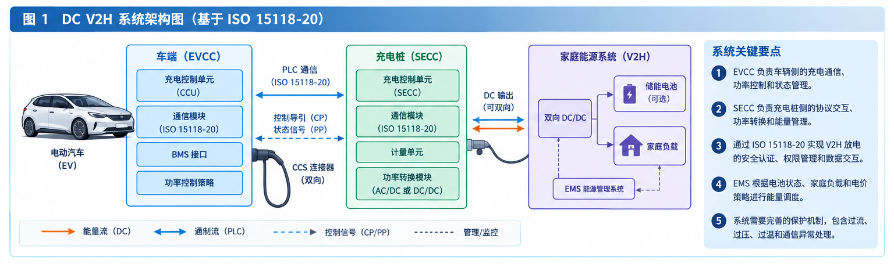
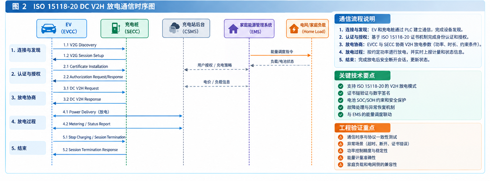
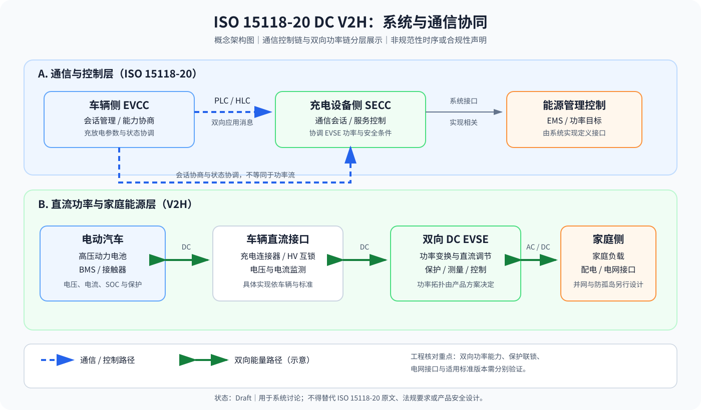

# ISO 15118 与 DC V2H 图文技术笔记

状态：Draft（工程学习材料；消息顺序、名称和要求必须依据项目采用的正式标准版本复核）

## 1. 本文目标与适用边界

本文用于理解 EVCC、SECC、双向功率变换设备、家庭能源管理系统（EMS）之间的逻辑关系，以及 DC V2H 场景下的通信流程和验证重点。它不是标准条款摘录，也不能代替 ISO 15118-20 正式文本、项目系统需求或一致性测试规范。

ISO 15118 不同部分/版本的消息、状态机和功能范围存在差异。进行设计或验证前，必须确认项目适用的标准完整编号、版本/年份、AC/DC 场景、双向能量传输能力、通信安全配置，以及测试规范版本。

## 2. 图 1：DC V2H 系统架构

> 注：本图为 AI 生成的概念示意图，用于辅助理解系统模块与能量/控制关系，不是标准原图或正式设计输出。

### 2.1 主要模块职责

| 模块 | 主要职责 | 设计/验证关注点 |
|---|---|---|
| EVCC | 车辆侧通信、会话与协议流程管理 | 消息状态、超时、异常恢复、参数合法性 |
| 车辆控制器/BMS 接口 | 提供电池状态、功率/电压/电流边界和许可 | 数据新鲜度、单位、上下限、失效默认值 |
| SECC | 充电设备侧通信与会话协调 | 协议协商、消息处理、会话资源和错误处理 |
| 双向功率变换单元 | 按系统设计实现 DC 能量双向转换 | 功率方向、限流限压、接触器及保护协调 |
| 家庭能源管理系统（EMS） | 根据家庭负载、电网状态和策略协调能量 | 功率指令边界、通信丢失时的安全策略 |
| 家庭负载/电网接口 | 能量消费、并网或离网接口（取决于系统方案） | 并离网策略、电气保护、法规与系统认证 |

### 2.2 先区分三类流

- **能量流：** V2H 放电时能量通常从车辆电池侧经双向功率变换设备流向家庭负载；具体拓扑、是否经过独立储能/逆变环节，以产品设计为准。
- **通信流：** EVCC 与 SECC 的通信路径、底层 PLC/连接导引实现和协议映射须按项目架构确认。
- **控制/管理流：** CP/PP、车辆/BMS 接口、功率控制和 EMS 指令并非同一类信号；应在系统框图中分别画出，避免把通信链路误画成能量链路。

## 3. 图 2：DC V2H 通信时序

> 注：本图为 AI 生成的概念示意图。图中示例阶段用于帮助理解流程，不应直接作为可执行的规范时序。如果用于严谨评审，需绘制逐消息的标准对照时序图，并为每条消息补充标准条款和前置状态。

### 3.1 时序分析模板

对每个消息/事件，逐项记录：

1. 发送方与接收方；
2. 前置状态、触发条件与允许的状态转换；
3. 消息名、关键字段、单位和取值范围；
4. 正常响应、拒绝响应、无响应、非法响应的处理；
5. 超时起点、超时值来源、是否允许重试；
6. 会话清理、功率降额/停止、接触器与保护动作；
7. 日志标记、时间基准和可复现的测试证据。

### 3.2 建议验证场景

| 场景 | 观察点 | 证据 |
|---|---|---|
| 协议能力不匹配 | 协商失败路径与资源清理 | EVCC/SECC 日志、消息跟踪 |
| 认证或安全通信失败 | 是否按需求拒绝、终止或降级 | 安全状态、错误码、证书测试记录 |
| 消息超时/乱序/非法字段 | 状态机是否保持一致，是否触发安全退出 | 注入条件、时间戳、预期/实测结果 |
| 放电过程中链路丢失 | 功率指令、能量输出和会话处理 | 功率/电流波形、故障日志 |
| 电池或设备边界动态变化 | 参数仲裁是否及时且不越界 | 请求值、允许值、实测值 |
| 正常停止和异常终止 | 能量停止、会话结束、资源释放 | 状态记录、接触器/功率状态 |

## 4. 设计与安全注意事项

- 通信协议层的状态不能替代功率控制和电气保护状态。
- 功率请求应经过车辆/BMS、充电设备和系统保护边界的共同约束；任何单一通信字段都不应绕过硬件保护。
- 通信中断、控制器重启、传感器异常、过流/过压/过温等故障的响应，应来自可追溯的系统需求和安全分析。
- 证书、身份信息、日志和测试附件需遵循最小化原则，避免保存不必要的敏感数据。
- AI 生成的图只能作为概念说明，不能伪装成标准原图、真实测试波形或经过认证的设计输出。

## 5. 标准与证据登记

对每条规范性结论建立记录：

| 字段 | 记录内容 |
|---|---|
| 标准 | 完整编号与部分 |
| 版本 | 年份/版本、勘误或修订信息 |
| 条款 | 具体条款号与页码 |
| 原文依据 | 合法获取的原文摘录或准确摘要 |
| 工程解释 | 对项目设计的影响 |
| 验证方法 | 测试用例编号、预期结果与实际证据 |
| 审核状态 | 待核对/已核对/不适用及审核人/日期 |

未核实的条款号不要猜测填写。

## 6. 相关知识库入口

- [EVCC 与充电系统](../../EVCC/历史资料/EVCC.md)
- [AUTOSAR 软件架构](../../../03-工程开发方法/嵌入式软件与AUTOSAR/AUTOSAR.md)
- [测试索引](../../../05-验证与质量管理/软件测试与HIL/历史资料/TEST_INDEX.md)
- [图文技术文档制作规范](../../../templates/IMAGE_DOCUMENT_GUIDE.md)
- [本主题图片目录](images/README.md)

## 图片资料

**图示说明：** ISO 15118-20 DC V2H 系统与通信协同示意图。来源：AI-generated conceptual engineering diagram; verify against the applicable ISO 15118-20 edition and system design。审核状态：Draft。请核对图中文字、单位、信号方向及适用标准版本。
